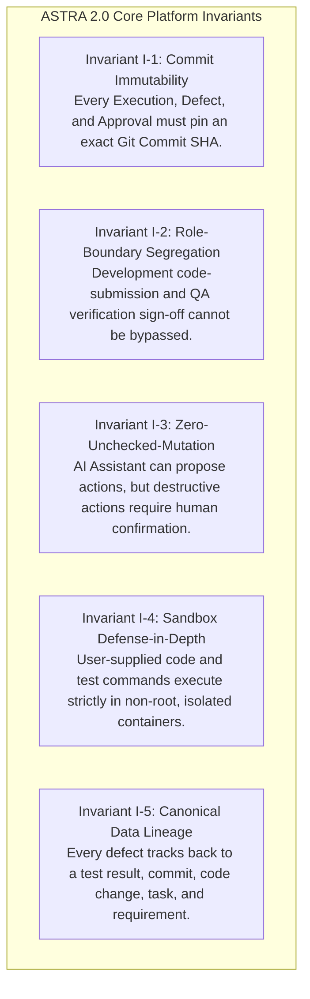
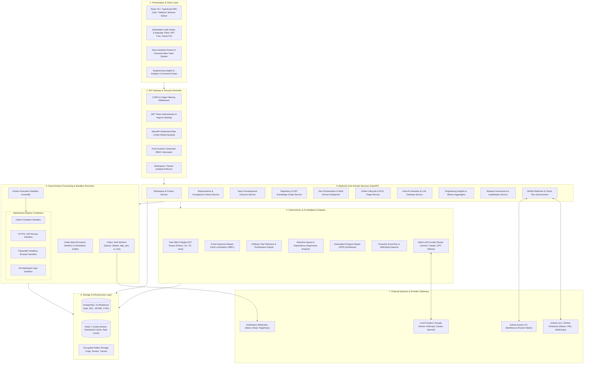
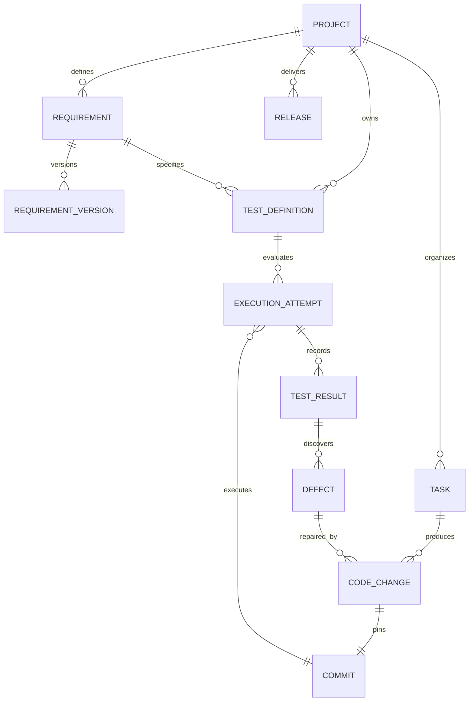
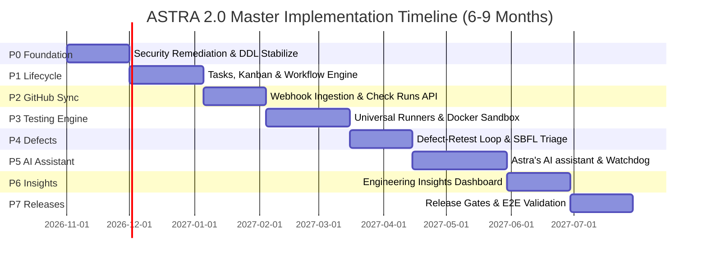

# ASTRA 2.0 — Master System Architecture & Engineering Blueprint

**Document Version:** 2.0.0-FINAL  
**Document Classification:** Master Architecture Specification & System Blueprint  
**Status:** Canonical Reference Architecture — Approved for Implementation  
**Target Horizon:** 6–9 Months Full Lifecycle Delivery  
**Target System:** ASTRA 2.0 (Collaborative, AI-Powered Software Engineering & Lifecycle Management Platform)  
**Primary Authors:** ASTRA Systems Architecture & Engineering Intelligence Group  

---

## Document Index & Quick Navigation
1. [Executive Summary & Architectural Vision](#1-executive-summary--architectural-vision)
2. [Architectural Tenets & System Invariants](#2-architectural-tenets--system-invariants)
3. [Top-Level System Topology & Layered Architecture](#3-top-level-system-topology--layered-architecture)
4. [Subsystem Responsibilities & Domain Boundaries](#4-subsystem-responsibilities--domain-boundaries)
5. [Role-Based Access Control (RBAC) & Fine-Grained Authorization Matrix](#5-role-based-access-control-rbac--fine-grained-authorization-matrix)
6. [End-to-End Collaborative Software Development Lifecycle Workflow](#6-end-to-end-collaborative-software-development-lifecycle-workflow)
7. [GitHub & CI/CD Hybrid Integration Architecture (Model B)](#7-github--cicd-hybrid-integration-architecture-model-b)
8. [Automated Testing & Multi-Runner Execution Architecture](#8-automated-testing--multi-runner-execution-architecture)
9. [Astra's AI Assistant & Proactive Intelligence Specification](#9-astras-ai-assistant--proactive-intelligence-specification)
10. [Shared Project Intelligence Layer (PIL) & Project Knowledge Graph (PKG)](#10-shared-project-intelligence-layer-pil--project-knowledge-graph-pkg)
11. [ASTRA Engineering Insights & Analytics Engine](#11-astra-engineering-insights--analytics-engine)
12. [Database Schema & Entity-Relationship Architecture](#12-database-schema--entity-relationship-architecture)
13. [API & Service Architecture](#13-api--service-architecture)
14. [Security, Compliance & Container Execution Isolation](#14-security-compliance--container-execution-isolation)
15. [Evaluation, Benchmarking & Quality Assurance Strategy](#15-evaluation-benchmarking--quality-assurance-strategy)
16. [Master Implementation Roadmap (P0 through P7)](#16-master-implementation-roadmap-p0-through-p7)

---

# 1. Executive Summary & Architectural Vision

## 1.1 The Evolutionary Leap: From Testing Engine to Lifecycle Platform
ASTRA began as a specialized, automated software quality and testing engine (Gen 1). Its core competencies centered around static repository analysis, Abstract Syntax Tree (AST) parsing, automated test case synthesis, containerized test execution, Spectrum-Based Fault Localization (SBFL), and machine-learning-driven test prioritization (XGBoost).

With **ASTRA 2.0**, the platform expands from an isolated testing utility into a **unified, collaborative, AI-powered Software Engineering and Lifecycle Management Platform**. 

```
┌─────────────────────────────────────────────────────────────────────────────────┐
│                                   ASTRA 2.0                                     │
│          Collaborative, AI-Powered Software Engineering & Lifecycle Platform    │
├─────────────────┬─────────────────┬───────────────────┬─────────────────────────┤
│  REQUIREMENTS   │   DEVELOPMENT   │     TESTING       │      GOVERNANCE         │
│  & PLANNING     │   & CODE BASE   │   & DEFECTS       │      & RELEASES         │
│  • Epics/Tasks  │  • Git Branches │  • Deterministic  │  • Release Gates        │
│  • Acceptance   │  • Pull Requests│  • Playwright/E2E │  • Quality Scorecards   │
│  • SRS Parsing  │  • Commit SHA   │  • SBFL / RCA     │  • Sign-off Audits      │
│  • Traceability │  • Code Studio  │  • Regression Map │  • Deployment Hooks     │
├─────────────────┴─────────────────┴───────────────────┴─────────────────────────┤
│                    SHARED PROJECT INTELLIGENCE LAYER (PIL)                      │
│     Unified Relational Graph • AST Call Graph • Entity Context Memory           │
├─────────────────────────────────────────────────────────────────────────────────┤
│                             ASTRA'S AI ASSISTANT                                │
│       Interactive Copilot (Chat/IDE)  •  Proactive Autonomous Watchdog          │
│               Multi-LLM Provider Engine (Claude / OpenAI / Gemini / Ollama)      │
└─────────────────────────────────────────────────────────────────────────────────┘
```

ASTRA 2.0 bridges the historic rift between developers, testers, administrators, and stakeholders:
- **Developers** implement features against explicit requirements, inspect AST-derived dependencies, debug test failures with stack-trace localization, and author code with real-time feedback.
- **Testers** design, synthesize, and execute targeted test suites across multiple runners, triage automated defect reports, and verify fixes against immutable Git commits.
- **Administrators** orchestrate sprints, enforce branch/release gates, manage RBAC memberships, and review AI-driven bottleneck diagnostics.
- **Viewers** monitor release readiness, audit defect velocity, and inspect quality metrics with zero risk of mutating project state.

## 1.2 Core Architectural Objectives
1. **Preserve Foundation Semantics:** Retain Gen 1 deterministic intelligence (AST parsers, SBFL fault localization, XGBoost flakiness classifier, selective regression algorithms) and Gen 2 canonical data models (`workspaces`, `g2_requirements`, `g2_test_definitions`, `g2_defects`).
2. **Hybrid Execution Model B:** Establish GitHub as the absolute source of truth for version control, while ASTRA manages the lifecycle, orchestrates Docker-isolated multi-runner test execution, and synchronizes status bidirectionally via webhooks and Check Runs.
3. **Immutable Commit Pinning:** Mandate that every requirement state, task submission, test run, defect report, and release approval is cryptographically pinned to an explicit Git commit SHA-1/SHA-256.
4. **Context-Aware AI Assistant & Proactive Watchdog:** Integrate *Astra's AI assistant* with dual capabilities: interactive contextual assistance across all four roles, and proactive event-driven monitoring that warns of bottlenecks, regression risks, and coverage gaps before deployment.
5. **Zero-Trust Multi-Tenancy & Hardened Execution:** Eliminate all legacy sandbox vulnerabilities (unsanitized `shell=True`, hardcoded credentials, authorization bypasses) through non-root container isolation, strict tenant scoping, and cryptographically verified HMAC webhooks.

---

# 2. Architectural Tenets & System Invariants

To guarantee platform integrity, stability, and auditability, ASTRA 2.0 enforces five non-negotiable **Platform Invariants**:



- **Invariant I-1 (Cryptographic Commit Immutability):** An execution run or defect cannot exist in a vacuum. It must reference `commit_sha` (40-hex or 64-hex string). If code changes, a new build and commit SHA must be registered.
- **Invariant I-2 (Role Boundary Segregation):** An author of a pull request or code change cannot unilaterally mark their own defect as `VERIFIED_CLOSED` or authorize their own `RELEASE_APPROVED` unless explicit override policies are configured by an `ADMIN`.
- **Invariant I-3 (Zero-Unchecked-Mutation / HITL):** Astra's AI assistant operates under a Human-In-The-Loop (HITL) gate for all consequential state changes (creating pull requests, closing defects, altering branch policies, modifying release gates).
- **Invariant I-4 (Sandbox Defense-in-Depth):** Arbitrary code execution on the host backend is strictly prohibited. All user-supplied commands and scripts run inside ephemeral Docker micro-containers with dropped Linux capabilities, read-only root filesystems, memory/CPU quotas, and disabled host networking.
- **Invariant I-5 (Canonical Data Lineage):** The data model enforces unbroken bidirectional traceability:
  $$\text{Requirement} \longleftrightarrow \text{Task} \longleftrightarrow \text{Commit/PR} \longleftrightarrow \text{Test Definition} \longleftrightarrow \text{Execution Attempt} \longleftrightarrow \text{Defect} \longleftrightarrow \text{Release Gate}$$

---

# 3. Top-Level System Topology & Layered Architecture

ASTRA 2.0 employs a modular, service-oriented monolithic architecture with strict logical service boundaries, backed by PostgreSQL 15, Redis 7, Celery background workers, Docker execution sandboxes, and external integration gateways.

## 3.1 Comprehensive Architectural Topology Diagram



---

# 4. Subsystem Responsibilities & Domain Boundaries

ASTRA 2.0 partitions platform responsibilities into 10 decoupled, high-cohesion domain modules.

```
┌────────────────────────────────────────────────────────────────────────────────────────┐
│                                 ASTRA 2.0 DOMAIN MODULES                               │
├──────────────────────┬────────────────────────┬────────────────────────────────────────┤
│ Module               │ Primary Responsibility │ Invariants & Cross-Module Boundaries   │
├──────────────────────┼────────────────────────┼────────────────────────────────────────┤
│ 1. Workspace & Proj  │ Multi-tenant bounds,   │ Projects belong to Workspaces; user    │
│    Management        │ project configs, RBAC  │ membership verified per project.       │
├──────────────────────┼────────────────────────┼────────────────────────────────────────┤
│ 2. Requirements &    │ Gherkin BDD, SRS       │ Version-controlled; acceptance criteria│
│    Traceability      │ ingestion, coverage    │ mapped to Test Definitions & Tasks.    │
├──────────────────────┼────────────────────────┼────────────────────────────────────────┤
│ 3. Development &     │ Kanban/Sprint tasks,   │ Tasks link to branches & commits; code │
│    Task Lifecycle    │ commit linkage, PRs    │ changes cannot bypass task status.     │
├──────────────────────┼────────────────────────┼────────────────────────────────────────┤
│ 4. Repository & AST  │ Tree-Sitter parsing,   │ Polyglot call graph; files, endpoints, │
│    Knowledge Graph   │ PKG graph construction │ and functions indexed to commit SHA.   │
├──────────────────────┼────────────────────────┼────────────────────────────────────────┤
│ 5. Automated Testing │ Runner dispatch,       │ Zero host execution; tests run in      │
│    & Multi-Runner    │ Docker sandboxing      │ ephemeral containers; logs captured.   │
├──────────────────────┼────────────────────────┼────────────────────────────────────────┤
│ 6. Defect & RCA      │ Defect tracking, SBFL  │ Defect linked to commit, test failure, │
│    Management        │ localization, comments │ and stack trace; verified upon retest. │
├──────────────────────┼────────────────────────┼────────────────────────────────────────┤
│ 7. Astra AI          │ Interactive copilot,   │ Context from PIL; multi-provider;      │
│    Assistant Engine  │ proactive background   │ destructive actions require HITL gate. │
├──────────────────────┼────────────────────────┼────────────────────────────────────────┤
│ 8. Code Review & APR │ Diff analysis, bug fix │ Automated Program Repair gated by Zero │
│    Synthesizer       │ generation, PR draft   │ Observed Regression gate before PR.    │
├──────────────────────┼────────────────────────┼────────────────────────────────────────┤
│ 9. Engineering       │ Quality scorecards,    │ Metrics derived directly from real run │
│    Insights          │ bottleneck analytics   │ data; no synthetic/mocked metrics.     │
├──────────────────────┼────────────────────────┼────────────────────────────────────────┤
│ 10. Release          │ Quality gates, audit   │ Admin-only sign-off; requires 0 open   │
│     Governance       │ trails, release builds │ critical defects and passed gate.      │
└──────────────────────┴────────────────────────┴────────────────────────────────────────┘
```

---

# 5. Role-Based Access Control (RBAC) & Fine-Grained Authorization Matrix

ASTRA 2.0 preserves the four canonical roles: `ADMIN`, `DEVELOPER`, `TESTER`, and `VIEWER`. 

To prevent authorization bypasses (such as those identified in the legacy security audit), authorization is evaluated at two levels:
1. **Global Role Tier:** Determines high-level platform capabilities (e.g., workspace creation, user management).
2. **Project Membership Context:** Enforces tenant isolation. A user with `DEVELOPER` role globally cannot touch Project B unless an explicit `ProjectMember` record associates them with Project B.

## 5.1 Definitive RBAC Permission Matrix

| Functional Capability | Operation / API Action | ADMIN | DEVELOPER | TESTER | VIEWER |
|---|---|:---:|:---:|:---:|:---:|
| **Workspace & Projects** | Create / Archive Workspace | ✅ | ❌ | ❌ | ❌ |
| | Create Project / Configure Repo | ✅ | ❌ | ❌ | ❌ |
| | Assign Members & Manage Roles | ✅ | ❌ | ❌ | ❌ |
| | View Project Metadata & Settings | ✅ | ✅ | ✅ | ✅ (Read) |
| **Requirements Management** | Create / Edit Requirements | ✅ | ✅ | ✅ | ❌ |
| | Approve Requirement Version | ✅ | ❌ | ✅ | ❌ |
| | Link Requirement to Test Suite | ✅ | ✅ | ✅ | ❌ |
| | View Requirements & Criteria | ✅ | ✅ | ✅ | ✅ (Read) |
| **Development & Tasks** | Create / Assign Development Tasks | ✅ | ✅ | ❌ | ❌ |
| | Update Task Status (Dev / In-Progress) | ✅ | ✅ | ❌ | ❌ |
| | Submit Task for Testing | ✅ | ✅ | ❌ | ❌ |
| | Close Task (Completed) | ✅ | ❌ (Req. QA) | ✅ (Verify) | ❌ |
| | View Tasks & Kanban Board | ✅ | ✅ | ✅ | ✅ (Read) |
| **Code & Repository** | Clone / Resync Repository | ✅ | ✅ | ❌ | ❌ |
| | Code Studio (Read File / AST) | ✅ | ✅ | ✅ | ✅ (Read) |
| | Code Studio (Edit / Save File) | ✅ | ✅ | ❌ | ❌ |
| | Trigger AST Re-indexing | ✅ | ✅ | ✅ | ❌ |
| **Testing Engine** | Author Test Definitions (Manual/Auto)| ✅ | ❌ | ✅ | ❌ |
| | Generate Tests (Rule/OpenAPI/LLM) | ✅ | ❌ | ✅ | ❌ |
| | Dispatch Test Execution Job | ✅ | ✅ (Self-Dev)| ✅ | ❌ |
| | Cancel Running Execution | ✅ | ✅ (Own Run) | ✅ | ❌ |
| | View Execution Results & Logs | ✅ | ✅ | ✅ | ✅ (Read) |
| **Defect Management** | Log / Create Defect | ✅ | ❌ | ✅ | ❌ |
| | Triage & Assign Defect | ✅ | ❌ | ✅ | ❌ |
| | Submit Defect Fix (Developer) | ✅ | ✅ | ❌ | ❌ |
| | Verify & Close Defect (Tester) | ✅ | ❌ | ✅ | ❌ |
| | View Defects & RCA Reports | ✅ | ✅ | ✅ | ✅ (Read) |
| **Astra AI Assistant** | Interactive Chat & Question Query | ✅ | ✅ | ✅ | ✅ (Context) |
| | Execute AI-Assisted Non-Destructive Action | ✅ | ✅ | ✅ | ❌ |
| | Execute AI-Assisted Consequential Action | ✅ (HITL) | ❌ | ❌ | ❌ |
| | Configure AI LLM Providers & Keys | ✅ | ❌ | ❌ | ❌ |
| **Release Management** | Configure Quality Gates | ✅ | ❌ | ❌ | ❌ |
| | Trigger Release Evaluation | ✅ | ✅ | ✅ | ❌ |
| | Grant Final Release Approval | ✅ | ❌ | ❌ | ❌ |
| | View Release Readiness Dashboard | ✅ | ✅ | ✅ | ✅ (Read) |

## 5.2 Tenant-Isolation & Contextual Dependency Injection
In FastAPI, every protected endpoint injects `get_current_active_user` and `verify_project_membership`:

```python
async def verify_project_membership(
    project_id: uuid.UUID,
    required_roles: Optional[List[UserRole]] = None,
    current_user: User = Depends(get_current_active_user),
    db: AsyncSession = Depends(get_db)
) -> Project:
    """
    Enforces strict project isolation.
    1. Super Admin bypasses project membership.
    2. Other roles must exist in project_members table with permitted role.
    """
    stmt = (
        select(Project, ProjectMember.role)
        .outerjoin(ProjectMember, (ProjectMember.project_id == Project.id) & (ProjectMember.user_id == current_user.id))
        .where(Project.id == project_id)
    )
    result = await db.execute(stmt)
    row = result.first()
    if not row:
        raise HTTPException(status_code=status.HTTP_404_NOT_FOUND, detail="Project not found")
        
    project, member_role = row
    effective_role = current_user.role if current_user.role == UserRole.ADMIN else member_role
    
    if not effective_role:
        raise HTTPException(
            status_code=status.HTTP_403_FORBIDDEN, 
            detail="Access denied: User is not assigned to this project"
        )
        
    if required_roles and effective_role not in required_roles:
        raise HTTPException(
            status_code=status.HTTP_403_FORBIDDEN,
            detail=f"Operation requires roles: {[r.value for r in required_roles]}"
        )
    return project
```

---

# 6. End-to-End Collaborative Software Development Lifecycle Workflow

ASTRA 2.0 formalizes the lifecycle into a 12-state deterministic state machine.

## 6.1 Lifecycle State Machine

```mermaid
stateDiagram-v2
    [*] --> ProjectCreated: Admin registers project & connects GitHub repo
    ProjectCreated --> RequirementsDrafted: Admin/Tester defines requirements & BDD criteria
    RequirementsDrafted --> RequirementsApproved: Admin approves requirements baseline
    
    RequirementsApproved --> TaskAssigned: Admin assigns development tasks
    TaskAssigned --> InDevelopment: Developer starts branch & implementation
    
    InDevelopment --> CodeSubmitted: Developer creates Pull Request / Commit
    
    CodeSubmitted --> TestingDispatched: Webhook triggers ASTRA Execution Engine
    
    state TestingEvaluation <<choice>>
    TestingDispatched --> TestingEvaluation: Docker Multi-Runner executes tests
    
    TestingEvaluation --> TestsFailed: Assertion or runtime failure detected
    TestingEvaluation --> TestsPassed: 100% assertions pass & quality gate met
    
    TestsFailed --> DefectLogged: ASTRA/Tester generates Defect with SBFL RCA
    DefectLogged --> DefectTriaged: Defect assigned to Developer with commit diff
    DefectTriaged --> InDevelopment: Developer fixes bug and resubmits commit
    
    TestsPassed --> CodeReview: Work submitted for peer review & AI audit
    CodeReview --> ReleaseCandidate: Review approved; release candidate built
    ReleaseCandidate --> ReleaseApproved: Admin authorizes final deployment
    ReleaseApproved --> [*]
```



## 6.2 The Defect-Retest Closed Loop
When a test failure occurs during code execution:
1. **RCA Capture:** ASTRA captures the failure logs, HTTP payloads, stack trace, and applies Ochiai SBFL to identify suspicious code lines in the repository.
2. **Defect Generation:** A `Defect` record is created, capturing `commit_sha`, `test_case_id`, `fault_localization_id`, and `severity`.
3. **Developer Resubmission:** The developer fixes the code on a new commit `C_fixed`.
4. **Selective Regression:** When `C_fixed` is submitted, ASTRA runs the AST Change Analyzer, detects changed methods, runs the targeted regression test suite first (Tier 1), followed by the full suite (Tier 2).
5. **Independent Verification:** The defect cannot be marked `CLOSED` by the developer. ASTRA automatically verifies the fix in a clean container, and the assigned `TESTER` or `ADMIN` performs final verification.

---

# 7. GitHub & CI/CD Hybrid Integration Architecture (Model B)

ASTRA 2.0 adopts **Hybrid Execution Model B**: GitHub maintains source code authority, while ASTRA maintains testing intelligence, lifecycle orchestration, and quality gating authority.

```
┌─────────────────────────────────────────────────────────────────────────────────────────┐
│                                 HYBRID EXECUTION MODEL B                                │
├─────────────────────────────────────────┬───────────────────────────────────────────────┤
│ GITHUB RESPONSIBILITIES                 │ ASTRA 2.0 RESPONSIBILITIES                    │
├─────────────────────────────────────────┼───────────────────────────────────────────────┤
│ • Git repository hosting (Git Trees)    │ • Requirements management & BDD criteria      │
│ • Branch policies & Pull Request UI     │ • Task orchestration & developer assignments  │
│ • Commit immutability (SHA-1 / SHA-256) │ • AST parsing & Code Knowledge Graph (PKG)    │
│ • CI workflow execution (GitHub Actions)│ • Docker-isolated Multi-Runner testing engine │
│ • Primary identity (GitHub App / OAuth) │ • Root Cause Analysis (SBFL & Stack traces)   │
│ • PR status check visual checks         │ • Machine learning test prioritization (XGB)  │
│ • Issue sync & repository webhooks      │ • Defect lifecycle & automated healing (APR)  │
│                                         │ • Astra's AI assistant & proactive watchdog   │
│                                         │ • Release gating & sign-off authority         │
└─────────────────────────────────────────┴───────────────────────────────────────────────┘
```

## 7.1 Webhook Ingestion & Cryptographic Verification
All incoming GitHub webhooks are processed through a hardened pipeline:
1. **HMAC-SHA256 Signature Verification:** Payloads must match `X-Hub-Signature-256` using the project's secret token. Unsigned or mismatched payloads are rejected with HTTP 401.
2. **Event Routing:** Supported events:
   - `push`: Ingests new commits, triggers selective regression testing if enabled.
   - `pull_request` (`opened`, `synchronize`): Triggers test plans, creates Check Runs.
   - `pull_request_review`: Synchronizes review status to ASTRA Code Review stage.
3. **Check Runs API Integration:** ASTRA creates a GitHub Check Run (`astra/quality-gate`) on the commit SHA. When tests complete, ASTRA updates the check status to `success` or `failure`, including a detailed Markdown summary of passed/failed tests and defect links directly in the GitHub PR.

---

# 8. Automated Testing & Multi-Runner Execution Architecture

ASTRA 2.0's execution engine is runner-agnostic, supporting heterogeneous test types through a standardized adapter protocol.

```
┌────────────────────────────────────────────────────────────────────────────────────────┐
│                              ASTRA 2.0 EXECUTION ENGINE                                │
├────────────────────────────────────────────────────────────────────────────────────────┤
│ 1. Universal Execution Adapter Protocol                                                │
│    ├── run_test(job: ExecutionJob) -> TestResultPayload                                │
│    ├── cancel_test(job_id: UUID) -> bool                                               │
│    └── stream_logs(job_id: UUID) -> AsyncGenerator[str]                                │
├────────────────────────────────────────────────────────────────────────────────────────┤
│ 2. Heterogeneous Runner Matrix                                                         │
│    ├── Runner A: Python Pytest Sandbox (Unit, Integration, Hypothesis)                 │
│    ├── Runner B: HTTPX REST/OpenAPI Sandbox (Deterministic API Contracts)              │
│    ├── Runner C: Playwright Headless Sandbox (E2E Frontend Browser UI Tests)           │
│    ├── Runner D: k6 Load Sandbox (Performance, Latency, Concurrency Thresholds)        │
│    └── Runner E: Manual Test Session Protocol (Step-by-step human verification)         │
├────────────────────────────────────────────────────────────────────────────────────────┤
│ 3. Docker Ephemeral Container Sandbox Controller                                       │
│    ├── Non-root execution user (UID 10001:10001)                                       │
│    ├── Read-only root filesystem (`--read-only`) with tmpfs `/tmp`                      │
│    ├── Dropped Linux capabilities (`--cap-drop=ALL`)                                   │
│    ├── Resource cgroups limits: 2.0 CPUs, 2048 MB RAM, 100 PIDs max                    │
│    └── Network isolation: Disabled (`--network none`) or internal sandbox bridge       │
└────────────────────────────────────────────────────────────────────────────────────────┘
```

## 8.1 Zero-Host Execution Guarantee
To remediate the critical RCE vulnerability found in legacy versions:
- `subprocess.Popen(..., shell=True)` on the host is strictly banned.
- All test runs, build steps, and user commands execute inside ephemeral Docker containers managed by `DockerSandboxManager`.
- Each container is assigned a unique UUID, strictly timed out (default 300s), and guaranteed destroyed upon completion via `try...finally` container cleanup.

---

# 9. Astra's AI assistant & Proactive Intelligence Specification

All artificial intelligence capabilities are consolidated under **Astra's AI assistant**, comprising two operating modes backed by a shared Project Intelligence Layer (PIL).

```
┌─────────────────────────────────────────────────────────────────────────────────────────┐
│                                 ASTRA'S AI ASSISTANT                                    │
├────────────────────────────────────────────┬────────────────────────────────────────────┤
│ INTERACTIVE COPILOT (Human-Prompted)       │ PROACTIVE WATCHDOG (Autonomous Background) │
├────────────────────────────────────────────┼────────────────────────────────────────────┤
│ • Contextual query chat in ASTRA UI        │ • Monitors repo webhooks, commits & PRs    │
│ • Architecture & code explanation          │ • Detects testing bottlenecks & delays     │
│ • Test case synthesis from acceptance BDD  │ • Flags high-risk regression surfaces      │
│ • Root cause analysis & stack trace triage │ • Identifies untested code / coverage gaps │
│ • Automated Program Repair (APR) fix draft │ • Generates pre-release readiness briefing │
│ • Task & defect drafting                   │ • Notifies team via Slack, Email, and UI   │
├────────────────────────────────────────────┴────────────────────────────────────────────┤
│ MULTI-LLM PROVIDER AGNOSTIC GATEWAY                                                     │
│ • Model Router: Gemini 1.5 Pro/Flash, Anthropic Claude 3.5 Sonnet, GPT-4o, Ollama/Local │
│ • Token-budgeted context packing (Relational entities + AST Call Graph + Recent Logs)   │
│ • Human-In-The-Loop (HITL) authorization barrier for all mutating actions               │
└─────────────────────────────────────────────────────────────────────────────────────────┘
```

## 9.1 Multi-LLM Provider Architecture
ASTRA 2.0 does not bind to a single AI vendor. The `LLMGatewayService` implements an abstraction interface:

```python
class LLMProviderProtocol(Protocol):
    async def generate_chat_response(
        self, messages: List[ChatMessage], system_prompt: str, temperature: float = 0.2
    ) -> str: ...
    
    async def stream_chat_response(
        self, messages: List[ChatMessage], system_prompt: str
    ) -> AsyncGenerator[str, None]: ...
```

Supported providers and dynamic routing strategy:
- **Google Gemini (Gemini 1.5 Pro / Flash):** Primary provider for long-context analysis (entire codebase AST call graphs, full SRS documents up to 1M tokens).
- **Anthropic Claude (Claude 3.5 Sonnet):** Primary provider for complex code synthesis, Automated Program Repair (APR), and deep Root Cause Analysis.
- **OpenAI (GPT-4o):** Alternative high-precision reasoning engine.
- **Local / Self-Hosted (Ollama / vLLM - Llama 3 / CodeLlama):** Air-gapped and enterprise on-premises deployments without external internet egress.

## 9.2 Human-In-The-Loop (HITL) Action Guard
When Astra's AI assistant suggests an action (e.g., "Create Defect for failed login suite", "Generate PR with repair patch", "Reassign task"):
1. The assistant emits an `AIActionProposal` with an action schema, diff preview, and reasoning.
2. The UI renders an interactive Action Card with **Approve** and **Reject** controls.
3. The action executes **only** if an authorized user (`ADMIN`, `DEVELOPER`, or `TESTER` according to the RBAC matrix) approves it.
4. Every approved action is recorded in `ai_action_executions` with the actor's user ID for full auditability.

---

# 10. Shared Project Intelligence Layer (PIL) & Project Knowledge Graph (PKG)

The Shared Project Intelligence Layer (PIL) is the central contextual nervous system of ASTRA 2.0. It bridges relational database entities, Git trees, Tree-Sitter AST call graphs, and test execution artifacts into a unified knowledge model.

## 10.1 Project Knowledge Model



## 10.2 Relational Graph Implementation in PostgreSQL
Rather than introducing the operational overhead of a standalone graph database (e.g., Neo4j), ASTRA 2.0 leverages PostgreSQL 15 with JSONB indexing and Recursive Common Table Expressions (CTEs), paired with an in-memory NetworkX projection in the Python engine for pathfinding and dependency traversal.

---

# 11. ASTRA Engineering Insights & Analytics Engine

The Engineering Insights subsystem converts raw execution artifacts and Git events into actionable engineering intelligence.

## 11.1 Core Metric Computations
1. **Quality Scorecard Index ($Q$):**
   $$Q = 100 \times \left( 0.40 \times \frac{T_{\text{passed}}}{T_{\text{total}}} + 0.25 \times C_{\text{coverage}} + 0.20 \times (1 - D_{\text{critical\_ratio}}) + 0.15 \times (1 - F_{\text{flakiness}}) \right)$$
2. **Regression Risk Score ($R_{\text{risk}}$):** Computed whenever a commit is submitted by calculating AST dependency centrality of modified files and historical failure frequencies of dependent test suites.
3. **Release Readiness Index ($RRI$):** A strict composite index requiring:
   - Zero open Critical/High defects.
   - 100% of required acceptance criteria verified by passing tests on the release commit SHA.
   - Tier 1 and Tier 2 regression suites passing with 0 regressions.

---

# 12. Database Schema & Entity-Relationship Architecture

ASTRA 2.0 extends the verified PostgreSQL canonical schema (`canonical.py`) with 12 new relational tables supporting collaborative tasks, code changes, release governance, and AI interactions.

## 12.1 Detailed Schema DDL Specifications

```sql
-- 1. Tasks & Development Management
CREATE TABLE tasks (
    id UUID PRIMARY KEY DEFAULT gen_random_uuid(),
    project_id UUID NOT NULL REFERENCES projects(id) ON DELETE CASCADE,
    requirement_id UUID REFERENCES g2_requirements(id) ON DELETE SET NULL,
    task_code VARCHAR(50) NOT NULL,
    title VARCHAR(255) NOT NULL,
    description TEXT NOT NULL,
    task_type VARCHAR(30) NOT NULL DEFAULT 'FEATURE', -- FEATURE, BUG, CHORE, SPIKE
    priority VARCHAR(20) NOT NULL DEFAULT 'MEDIUM',   -- LOW, MEDIUM, HIGH, CRITICAL
    status VARCHAR(30) NOT NULL DEFAULT 'TODO',       -- TODO, IN_PROGRESS, TESTING, DONE, BLOCKED
    assigned_to UUID REFERENCES users(id) ON DELETE SET NULL,
    created_by UUID REFERENCES users(id) ON DELETE SET NULL,
    branch_name VARCHAR(255),
    created_at TIMESTAMPTZ NOT NULL DEFAULT clock_timestamp(),
    updated_at TIMESTAMPTZ NOT NULL DEFAULT clock_timestamp(),
    CONSTRAINT uq_project_task_code UNIQUE (project_id, task_code)
);
CREATE INDEX idx_tasks_project_status ON tasks(project_id, status);

-- 2. Code Changes & Git Commit Tracking
CREATE TABLE code_changes (
    id UUID PRIMARY KEY DEFAULT gen_random_uuid(),
    project_id UUID NOT NULL REFERENCES projects(id) ON DELETE CASCADE,
    task_id UUID REFERENCES tasks(id) ON DELETE SET NULL,
    commit_sha VARCHAR(64) NOT NULL,
    parent_sha VARCHAR(64),
    branch VARCHAR(255) NOT NULL,
    author_name VARCHAR(100) NOT NULL,
    author_email VARCHAR(255) NOT NULL,
    commit_message TEXT NOT NULL,
    changed_files JSONB NOT NULL DEFAULT '[]', -- List of modified paths and diff stats
    github_pr_number INTEGER,
    committed_at TIMESTAMPTZ NOT NULL,
    created_at TIMESTAMPTZ NOT NULL DEFAULT clock_timestamp()
);
CREATE INDEX idx_code_changes_commit ON code_changes(project_id, commit_sha);

-- 3. Release Governance & Sign-Off
CREATE TABLE releases (
    id UUID PRIMARY KEY DEFAULT gen_random_uuid(),
    project_id UUID NOT NULL REFERENCES projects(id) ON DELETE CASCADE,
    release_version VARCHAR(50) NOT NULL,
    target_commit_sha VARCHAR(64) NOT NULL,
    status VARCHAR(30) NOT NULL DEFAULT 'DRAFT', -- DRAFT, EVALUATING, READY, APPROVED, REJECTED, DEPLOYED
    quality_scorecard JSONB NOT NULL DEFAULT '{}',
    readiness_notes TEXT,
    approved_by UUID REFERENCES users(id) ON DELETE SET NULL,
    approved_at TIMESTAMPTZ,
    created_by UUID REFERENCES users(id) ON DELETE SET NULL,
    created_at TIMESTAMPTZ NOT NULL DEFAULT clock_timestamp(),
    updated_at TIMESTAMPTZ NOT NULL DEFAULT clock_timestamp(),
    CONSTRAINT uq_project_release_version UNIQUE (project_id, release_version)
);

-- 4. Astra's AI assistant Conversations & Audit Logging
CREATE TABLE ai_conversations (
    id UUID PRIMARY KEY DEFAULT gen_random_uuid(),
    project_id UUID NOT NULL REFERENCES projects(id) ON DELETE CASCADE,
    user_id UUID NOT NULL REFERENCES users(id) ON DELETE CASCADE,
    title VARCHAR(255) NOT NULL DEFAULT 'New Conversation',
    context_scope JSONB NOT NULL DEFAULT '{}', -- e.g. {"commit_sha": "...", "task_id": "..."}
    created_at TIMESTAMPTZ NOT NULL DEFAULT clock_timestamp(),
    updated_at TIMESTAMPTZ NOT NULL DEFAULT clock_timestamp()
);

CREATE TABLE ai_messages (
    id UUID PRIMARY KEY DEFAULT gen_random_uuid(),
    conversation_id UUID NOT NULL REFERENCES ai_conversations(id) ON DELETE CASCADE,
    sender_role VARCHAR(20) NOT NULL, -- USER, ASSISTANT, SYSTEM
    content TEXT NOT NULL,
    llm_provider VARCHAR(50),         -- GEMINI, CLAUDE, OPENAI, OLLAMA
    llm_model VARCHAR(100),
    tokens_used INTEGER DEFAULT 0,
    action_proposals JSONB DEFAULT '[]',
    created_at TIMESTAMPTZ NOT NULL DEFAULT clock_timestamp()
);

CREATE TABLE ai_action_executions (
    id UUID PRIMARY KEY DEFAULT gen_random_uuid(),
    project_id UUID NOT NULL REFERENCES projects(id) ON DELETE CASCADE,
    conversation_id UUID REFERENCES ai_conversations(id) ON DELETE SET NULL,
    action_type VARCHAR(50) NOT NULL, -- CREATE_TASK, ASSIGN_DEFECT, GENERATE_TEST, DRAFT_PR
    payload JSONB NOT NULL,
    proposed_by VARCHAR(50) NOT NULL DEFAULT 'ASTRA_AI',
    approved_by UUID NOT NULL REFERENCES users(id) ON DELETE RESTRICT,
    status VARCHAR(30) NOT NULL DEFAULT 'EXECUTED', -- EXECUTED, FAILED, REVERTED
    execution_result JSONB NOT NULL DEFAULT '{}',
    executed_at TIMESTAMPTZ NOT NULL DEFAULT clock_timestamp()
);

-- 5. Proactive Watchdog Event Logs
CREATE TABLE proactive_event_logs (
    id UUID PRIMARY KEY DEFAULT gen_random_uuid(),
    project_id UUID NOT NULL REFERENCES projects(id) ON DELETE CASCADE,
    trigger_type VARCHAR(50) NOT NULL, -- COMMIT_DETECTED, REGRESSION_RISK, BOTTLENECK, DEFECT_SPIKE
    severity VARCHAR(20) NOT NULL DEFAULT 'INFO', -- INFO, WARNING, CRITICAL
    title VARCHAR(255) NOT NULL,
    details JSONB NOT NULL DEFAULT '{}',
    acknowledged BOOLEAN NOT NULL DEFAULT FALSE,
    acknowledged_by UUID REFERENCES users(id) ON DELETE SET NULL,
    created_at TIMESTAMPTZ NOT NULL DEFAULT clock_timestamp()
);
CREATE INDEX idx_proactive_project_unack ON proactive_event_logs(project_id, acknowledged);
```

---

# 13. API & Service Architecture

ASTRA 2.0 exposes a clean, versioned RESTful API under `/api/v1/`, supplemented by WebSocket and Server-Sent Events (SSE) connections for live AI token streaming and real-time test execution logs.

## 13.1 Expanded RESTful Endpoints

```
┌────────────────────────────────────────────────────────────────────────────────────────┐
│                              ASTRA 2.0 REST API CATALOG                                │
├────────────────────────────────────────────────────────────────────────────────────────┤
│ Tasks & Development Lifecycle                                                          │
│   POST   /api/v1/projects/{project_id}/tasks                 Create task               │
│   GET    /api/v1/projects/{project_id}/tasks                 List tasks (Kanban)       │
│   GET    /api/v1/projects/{project_id}/tasks/{task_id}       Get task details          │
│   PATCH  /api/v1/projects/{project_id}/tasks/{task_id}       Update task status/assign │
│   POST   /api/v1/projects/{project_id}/tasks/{task_id}/submit Submit code for testing │
├────────────────────────────────────────────────────────────────────────────────────────┤
│ GitHub Synchronizer & Webhooks                                                         │
│   POST   /api/v1/webhooks/github                             GitHub Webhook Ingestion  │
│   GET    /api/v1/projects/{project_id}/branches              List repo branches        │
│   GET    /api/v1/projects/{project_id}/commits               List tracked commits      │
│   POST   /api/v1/projects/{project_id}/check-runs/dispatch   Trigger GitHub Check Run  │
├────────────────────────────────────────────────────────────────────────────────────────┤
│ Astra AI Assistant & Proactive Watchdog                                                │
│   POST   /api/v1/projects/{project_id}/ai/conversations      Start AI conversation     │
│   POST   /api/v1/projects/{project_id}/ai/conversations/{id} Send message / query chat │
│   GET    /api/v1/projects/{project_id}/ai/conversations/{id}/stream Live SSE stream    │
│   POST   /api/v1/projects/{project_id}/ai/actions/execute    Approve & execute action  │
│   GET    /api/v1/projects/{project_id}/ai/proactive-events   List watchdog events      │
│   POST   /api/v1/projects/{project_id}/ai/proactive-events/{id}/ack Acknowledge alert  │
├────────────────────────────────────────────────────────────────────────────────────────┤
│ Engineering Insights & Analytics                                                       │
│   GET    /api/v1/projects/{project_id}/insights/summary      Executive dashboard stats │
│   GET    /api/v1/projects/{project_id}/insights/bottlenecks  Testing & dev bottlenecks │
│   GET    /api/v1/projects/{project_id}/insights/regression   Regression risk index     │
├────────────────────────────────────────────────────────────────────────────────────────┤
│ Release Governance                                                                     │
│   POST   /api/v1/projects/{project_id}/releases              Create release candidate  │
│   GET    /api/v1/projects/{project_id}/releases              List project releases     │
│   POST   /api/v1/projects/{project_id}/releases/{id}/evaluate Evaluate quality gates  │
│   POST   /api/v1/projects/{project_id}/releases/{id}/approve  Admin release sign-off   │
└────────────────────────────────────────────────────────────────────────────────────────┘
```

---

# 14. Security, Compliance & Container Execution Isolation

ASTRA 2.0 rectifies all known architectural security vulnerabilities through a defense-in-depth model.

```
┌─────────────────────────────────────────────────────────────────────────────────────────┐
│                           ASTRA 2.0 SECURITY ARCHITECTURE                               │
├───────────────────────────────┬─────────────────────────────────────────────────────────┤
│ THREAT VECTOR                 │ HARDENED ARCHITECTURAL MITIGATION                       │
├───────────────────────────────┼─────────────────────────────────────────────────────────┤
│ Arbitrary Remote Code         │ Host shell execution is replaced by Docker container    │
│ Execution (RCE)               │ sandboxes with dropped capabilities and non-root users. │
├───────────────────────────────┼─────────────────────────────────────────────────────────┤
│ Hardcoded Credentials &       │ Hardcoded backdoor logic eliminated; all authentication │
│ Password Bypasses             │ strictly uses Argon2id password hashing + secure JWT.   │
├───────────────────────────────┼─────────────────────────────────────────────────────────┤
│ Tenant / Project Isolation    │ Every endpoint queries project membership explicitly;   │
│ Bypass                        │ cross-tenant data access is blocked at the ORM layer.   │
├───────────────────────────────┼─────────────────────────────────────────────────────────┤
│ Webhook Forgery & Tampering   │ Incoming GitHub webhooks validated with HMAC-SHA256     │
│                               │ cryptographic signature verification.                   │
├───────────────────────────────┼─────────────────────────────────────────────────────────┤
│ PII & Secret Leakage          │ Sensitive environment variables, authorization tokens,   │
│                               │ and passwords automatically redacted from logs.         │
└───────────────────────────────┴─────────────────────────────────────────────────────────┘
```

---

# 15. Evaluation, Benchmarking & Quality Assurance Strategy

To validate ASTRA 2.0 objectively against industrial standards, the platform undergoes continuous benchmark evaluation.

```
┌────────────────────────────────────────────────────────────────────────────────────────┐
│                        ASTRA 2.0 EVALUATION & BENCHMARK MATRIX                         │
├──────────────────────────────┬────────────────────────┬────────────────────────────────┤
│ Benchmark Suite              │ Target Metrics         │ Acceptance Criteria            │
├──────────────────────────────┼────────────────────────┼────────────────────────────────┤
│ 50-Bug Polyglot Benchmark    │ Fault Detection Rate,  │ $\ge 90\%$ bugs identified;    │
│ (Python, Go, Node, Java)     │ Mean Time To Localize  │ localization Top-3 rank $>80\%$.│
├──────────────────────────────┼────────────────────────┼────────────────────────────────┤
│ 100 Negative Controls        │ False Positive Rate    │ $0\%$ false positive alerts on │
│ (Known-Clean Repositories)   │ on clean codebases     │ passing canonical test suites. │
├──────────────────────────────┼────────────────────────┼────────────────────────────────┤
│ Selective Regression Speedup │ Test Suite Run Time,   │ $\ge 60\%$ reduction in suite  │
│ vs. Exhaustive Testing       │ Fault Recall Rate      │ duration; $100\%$ fault recall.│
├──────────────────────────────┼────────────────────────┼────────────────────────────────┤
│ AI Assistant Action Accuracy │ Hallucination Rate,    │ Zero unauthorized mutations;   │
│ & HITL Safety Boundary       │ Human Acceptance Rate  │ $\ge 85\%$ action acceptance.  │
└──────────────────────────────┴────────────────────────┴────────────────────────────────┘
```

---

# 16. Master Implementation Roadmap (P0 through P7)

The engineering roadmap spans an estimated **6–9 month horizon**, divided into 8 focused, sequential priority phases.



## Detailed Phased Breakdown

### Phase P0: Foundation Stabilization & Security Remediation (Month 1)
- [ ] Remove hardcoded password bypasses in `auth_service.py`.
- [ ] Replace host `subprocess` sandbox server with Docker container runner.
- [ ] Implement `verify_project_membership` guard across all API routers.
- [ ] Apply Alembic migration for ASTRA 2.0 tables (`tasks`, `code_changes`, `releases`, `ai_*`).
- [ ] Verify 100% test pass rate on Gen 1 / Gen 2 compatibility suites.

### Phase P1: Project Management & Workflow Engine (Month 2)
- [ ] Implement Tasks REST API (`/projects/{id}/tasks`).
- [ ] Build Kanban Board and Task Detail views in React frontend.
- [ ] Implement Requirements-to-Task linkage and acceptance criteria tracker.
- [ ] Enforce workflow state transitions (Todo $\rightarrow$ In Progress $\rightarrow$ Testing $\rightarrow$ Done).

### Phase P2: GitHub & CI/CD Hybrid Integration (Month 3)
- [ ] Hardened HMAC-SHA256 webhook receiver.
- [ ] Implement GitHub Check Runs API client for PR status reporting.
- [ ] Synchronize Git branches, commits, and PR metadata to `code_changes` table.
- [ ] Enforce Invariant I-1 (Every action pinned to explicit commit SHA).

### Phase P3: Universal Testing Engine & Isolation (Months 4–5)
- [ ] Implement Universal Execution Adapter protocol.
- [ ] Deploy container sandboxes for Pytest, HTTPX, Playwright, and k6.
- [ ] Eliminate host RCE vectors with read-only filesystems and dropped capabilities.
- [ ] Implement real-time log streaming over Server-Sent Events (SSE).

### Phase P4: Defect Lifecycle & RCA Closed-Loop (Month 5)
- [ ] Automate defect generation from test failures with Ochiai SBFL localization.
- [ ] Implement Defect Triage, Developer Fix Submission, and Retesting workflow.
- [ ] Enforce Invariant I-2 (Developers cannot unilaterally close defects without QA retest).

### Phase P5: Astra's AI assistant & Proactive Watchdog (Months 6–7)
- [ ] Implement Multi-LLM Provider Router (Gemini, Claude, GPT-4o, Ollama).
- [ ] Build Shared Project Intelligence Layer (PIL) context packing engine.
- [ ] Implement interactive AI Assistant drawer with role-tailored capabilities.
- [ ] Deploy Celery Beat proactive watchdog daemon for bottlenecks and regression risks.
- [ ] Enforce Invariant I-3 (Human-In-The-Loop approval cards for all mutations).

### Phase P6: ASTRA Engineering Insights & Analytics (Month 8)
- [ ] Implement Quality Scorecard and Regression Risk index calculation.
- [ ] Build Engineering Insights dashboard with charts, bottlenecks, and team metrics.
- [ ] Deliver role-customized executive and engineering views.

### Phase P7: Release Governance & Platform Evaluation (Month 9)
- [ ] Implement Release Candidates, automated Quality Gate evaluation, and Admin sign-off.
- [ ] Execute 50-Bug Polyglot Benchmark and 100 Negative Controls.
- [ ] Conduct end-to-end user acceptance testing across Admin, Developer, Tester, and Viewer roles.
- [ ] Finalize production deployment documentation and operator manuals.

---

**Architecture Status:** Approved Canonical Architecture  
**Next Step:** Execution of Phase P0 (Foundation Stabilization & Schema Migration)
