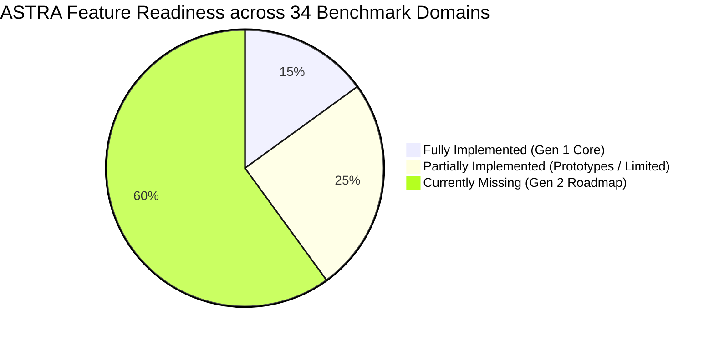

# ASTRA Gen 2 — Master Benchmark Gap Analysis & Feature Blueprint

**Document Version**: 2.0.0  
**Target Platform**: ASTRA Gen 2 (Autonomous & All-in-One Enterprise Software Testing Platform)  
**Author**: DeepMind Advanced Agentic Coding Pair  
**Status**: Comprehensive Baseline Review & Strategic Implementation Roadmap  

---

## Executive Summary

ASTRA Gen 1 established an advanced, research-grade core centered around **AST static analysis, Program Knowledge Graphs (PKG), automated synthetic invariant generation, Spectrum-Based Fault Localization (Tarantula/Ochiai SBFL), ML flakiness prediction (XGBoost), and self-healing tests**.

However, when measured against the industry benchmark checklist for a **comprehensive, all-in-one software testing platform** (encompassing TestRail, Jira, Postman, Playwright, k6, and OWASP ZAP capabilities), ASTRA Gen 1 functions primarily as an **API Test Intelligence Engine** rather than a full-lifecycle Quality Platform.

This document systematically audits all **34 benchmark dimensions**, identifying:
1. **Existing Capabilities** in ASTRA today.
2. **Feature Gaps & Deficiencies** that are currently lacked.
3. **Gen 2 Strategic Architecture & Implementation Phases** to elevate ASTRA into an all-in-one QA powerhouse.

---

## Complete 34-Section Gap Analysis Matrix



---

### 1. Core Modules of a Software Testing Platform

| Module | Benchmark Requirement | Current ASTRA Status | Gap / Missing in Current Software |
|---|---|:---:|---|
| **Test Management** | Projects, test plans, test suites, test cases, test steps, test cycles, schedules. | ⚠️ Partial | Has synthetic test suites and test runs. **Lacks manual test authoring, step-by-step test cases, test plans, test cycles, execution windows, and tester assignments.** |
| **Test Automation** | Web, mobile, API, desktop, regression; parallel scheduling & runners. | ⚠️ Partial | Has automated synthetic HTTP execution for REST endpoints. **Lacks Web UI (Playwright/Selenium), Mobile (Appium), Desktop testing, and multi-runner distributed grids.** |
| **Defect & Bug Management** | Defect lifecycle, ownership, severity, retest verification, evidence. | ⚠️ Partial | Has automated failure analyses, stack trace parsing, and fingerprint clustering. **Lacks formal manual Defect entity, human triage workflows, custom defect states, and 2-way Jira/GitHub sync.** |
| **Reporting & Analytics** | Pass/fail rates, coverage, defect trends, flakiness, release readiness. | ⚠️ Partial | Has execution pass/fail metrics, ML flakiness score, and Executive Quality Audit HTML. **Lacks Requirement Traceability Matrix (RTM), defect leakage, team workload, and release readiness dashboards.** |
| **Integrations & Collaboration** | SCM, CI/CD, issue trackers, chat tools, cloud test clouds. | ⚠️ Partial | Has GitHub Webhook PR checking and Slack/Teams alert webhooks. **Lacks GitLab, Bitbucket, Jenkins, Azure DevOps, Jira, BrowserStack, and Sauce Labs integrations.** |

---

### 2. Project and Workspace Management

- **Currently Implemented**:
  - `Project` database model with name, description, repository URL, default branch, detected framework, and owner ID.
  - Project deletion with cascading cleanup.
  - Project-level analytics and dashboard overviews.
- **Lacked / Missing for Gen 2**:
  - ❌ **Workspace Multi-Tenancy**: Organization and workspace grouping (Workspace $\rightarrow$ Projects $\rightarrow$ Suites).
  - ❌ **Project Archiving & Cloning**: Ability to archive inactive projects or clone existing project templates and workflows.
  - ❌ **Milestones & Sprints**: Association with project delivery milestones, sprint cycles, and deadlines.
  - ❌ **Stakeholder Assignments**: Distinct assignments for QA Leads, Automation Engineers, Developers, and Viewers per project.
  - ❌ **Project Configuration & Custom Fields**: Project-level custom tags, fields, environments, and execution policies.
  - ❌ **Project Import & Export**: Exporting project metadata, test configurations, and history in JSON/ZIP bundles.

---

### 3. Requirements Management & Traceability

- **Currently Implemented**:
  - `RequirementDocument` and `RequirementSpecModel` tables.
  - NLP/LLM extraction of specifications from raw text or uploaded documents.
  - Endpoint mapping linking requirements to discovered routes.
- **Lacked / Missing for Gen 2**:
  - ❌ **Manual Requirement Authoring**: Form-based creation with unique alphanumeric IDs (e.g., `REQ-101`), acceptance criteria (Given/When/Then), priority, and categories.
  - ❌ **Requirement Hierarchy & Dependencies**: Epics, user stories, sub-requirements, and dependency trees.
  - ❌ **Non-Functional Requirements (NFR)**: Managing performance, security, and compliance requirements alongside functional ones.
  - ❌ **Requirement Versioning & Diffing**: Tracking changes to requirements over time with change histories.
  - ❌ **Automated Requirement Coverage Calculation**: Exact metrics calculating what percentage of requirements have automated/manual tests and what percentage are passing.
  - ❌ **Change Impact Analysis on Requirements**: Auto-flagging test cases and defects when a requirement specification changes.
  - ❌ **Requirement Review & Approval Workflow**: Formal Draft $\rightarrow$ Under Review $\rightarrow$ Approved $\rightarrow$ Deprecated states.

---

### 4. Test Case Management

- **Currently Implemented**:
  - `TestCase` model containing JSON specifications, test types (Happy Path, Boundary, Invalid Type, Null, etc.), and execution order.
  - Machine-generated synthetic test cases for REST endpoints.
- **Lacked / Missing for Gen 2**:
  - ❌ **Manual Step-by-Step Test Authoring**: Numbered test steps with Step Description, Test Data, and Expected Results.
  - ❌ **Preconditions and Postconditions**: Clean setup and teardown instructions per test case.
  - ❌ **Test Suite & Folder Tree Hierarchy**: Nested folders/subfolders (e.g., `Authentication/OAuth2/RefreshTokens`) for organizing large test libraries.
  - ❌ **Test Case Reuse & Shared Steps**: Modular reusable step libraries (e.g., "Standard User Login Step") shared across multiple test cases.
  - ❌ **Test Case Lifecycle & Review Status**: Draft $\rightarrow$ Ready for Review $\rightarrow$ Approved $\rightarrow$ Obsolete workflows.
  - ❌ **Rich Test Types**: Smoke, Sanity, Exploratory, UAT, Accessibility, Cross-Browser, and Performance test categorizations.
  - ❌ **Bulk Operations**: Bulk import/export via Excel/CSV, bulk tagging, bulk assignment, and bulk status updates.
  - ❌ **Duplicate Test Case Detection**: Detecting redundant test cases across suites.

---

### 5. Test Planning & Test Cycle Management

- **Currently Implemented**:
  - None. (ASTRA currently runs tests ad-hoc or triggered via CI/CD on git push).
- **Lacked / Missing for Gen 2**:
  - ❌ **Test Plans**: Formal test plans defining scope, entry criteria, exit criteria, and release targets.
  - ❌ **Test Cycles**: Execution cycles with assigned testers, planned start/end dates, target builds, and environments.
  - ❌ **Execution Scheduling**: Recurring test cycle schedules (e.g., nightly regression at 2 AM).
  - ❌ **Risk-Based Test Selection**: Selecting test cases based on business risk, code churn, and historical failure rate.
  - ❌ **Test Plan Cloning**: One-click cloning of test plans for subsequent sprint/regression cycles.
  - ❌ **Test Sign-Off & Approvals**: Formal QA Lead and Product Owner sign-off records with audit timestamps.

---

### 6. Manual Test Execution

- **Currently Implemented**:
  - None. (ASTRA execution is 100% automated via `SandboxHttpExecutor`).
- **Lacked / Missing for Gen 2**:
  - ❌ **Interactive Execution Workspace**: A dedicated runner UI presenting test steps one by one.
  - ❌ **Step-Level Status Marking**: Passing, failing, blocking, or skipping individual steps.
  - ❌ **Actual Results & Evidence Capture**: Capturing tester notes, attaching screenshots, screen recordings, and logs during execution.
  - ❌ **Direct Defect Logging**: "One-click Log Bug" directly from a failed step pre-populating steps to reproduce.
  - ❌ **Session Pause & Resume**: Saving partial execution progress and resuming later or reassigning to another tester.
  - ❌ **Exploratory Testing Session Mode**: Time-boxed exploratory sessions with charter, dynamic notes, and screen capture.

---

### 7. Test Data Management (TDM)

- **Currently Implemented**:
  - Basic synthetic data generators producing random strings, numbers, UUIDs, and boundary conditions during test generation.
- **Lacked / Missing for Gen 2**:
  - ❌ **Test Dataset Repository**: Creating, editing, and managing reusable datasets (CSV, JSON, SQL fixtures).
  - ❌ **Parameterization & Variables**: Dynamic variable substitution in test cases (e.g., `{{baseUrl}}`, `{{authToken}}`, `{{customer_id}}`).
  - ❌ **Data Masking & Anonymization**: Tools to sanitize and anonymize production-derived datasets for QA use.
  - ❌ **Test Identity / Account Pooling**: Managing shared test accounts with checkout/lock mechanisms to prevent concurrent test collision.
  - ❌ **Data Teardown & Rollback Automation**: Automated database reset and cleanup fixtures after test execution.

---

### 8. Defect and Bug Tracking

- **Currently Implemented**:
  - `FailureAnalysisModel` parsing stack traces, calculating Tarantula/Ochiai SBFL fault localization, and generating fingerprints.
  - `DefectClusterModel` grouping similar failures into clusters with occurrence counters.
- **Lacked / Missing for Gen 2**:
  - ❌ **First-Class Defect Lifecycle Entity**: Full workflow states (`New → Triaged → Assigned → In Progress → Fixed → Ready for Retest → Verified → Closed`).
  - ❌ **Severity & Priority Governance**: Blocker, Critical, Major, Minor, Trivial ratings with SLA escalation rules.
  - ❌ **Developer Assignment & Comments**: Assigning bugs to developers, internal discussion threads, and notifications.
  - ❌ **Bi-Directional Jira / Azure DevOps / GitHub Issues Sync**: Creating Jira tickets from ASTRA and syncing status when tickets are resolved.
  - ❌ **Defect Leakage & Aging Analytics**: Measuring how long bugs stay open and calculating production defect escape rates.
  - ❌ **Automatic Retest Triggers**: Triggering re-execution of the specific failed test case once a defect is marked "Fixed".

---

### 9. Test Automation Management & Multi-Framework Orchestration

- **Currently Implemented**:
  - Native Python-based HTTP executor for REST APIs with parallel thread execution.
- **Lacked / Missing for Gen 2**:
  - ❌ **Multi-Framework Ingestion**: Ingesting and running external automation scripts (Playwright, Cypress, Selenium, PyTest, JUnit, Postman).
  - ❌ **Distributed Execution Agent Pools**: Master-worker architecture where runner agents execute on remote VM/Docker nodes.
  - ❌ **Cross-Browser & Multi-OS Matrix**: Running automated tests across Chrome, Firefox, WebKit, Edge on Windows/Linux/macOS.
  - ❌ **Smart Test Retries**: Configurable retry policies (e.g., retry up to 2 times only if flaky).
  - ❌ **Execution Artifact Capture**: Storing full Playwright traces, video recordings, and HAR network logs.

---

### 10. API Testing (Expanded Capabilities)

- **Currently Implemented**:
  - REST API endpoint discovery via AST parsing.
  - Automated synthetic request generation and HTTP validation.
- **Lacked / Missing for Gen 2**:
  - ❌ **Multi-Protocol Support**: GraphQL (queries/mutations/subscriptions), gRPC / Protocol Buffers, and WebSocket testing.
  - ❌ **Interactive API Request Builder**: Postman-style UI to craft requests, inspect headers, and test ad-hoc.
  - ❌ **Advanced Authentication Flows**: OAuth 2.0 PKCE, AWS SigV4, SAML tokens, and API Key management.
  - ❌ **API Request Chaining**: Multi-step workflows (e.g., Step 1: POST `/login` $\rightarrow$ extract `token` $\rightarrow$ Step 2: GET `/profile` with bearer token).
  - ❌ **OpenAPI / Postman Import & Export**: One-click import of Swagger/OpenAPI v3 and Postman Collections.
  - ❌ **API Contract Testing**: Pact-compatible consumer-driven contract testing.

---

### 11. Web Application Testing

- **Currently Implemented**:
  - Framework detection recognizes React, Vue, Next.js, Svelte in repositories, but executes no UI browser tests.
- **Lacked / Missing for Gen 2**:
  - ❌ **Headless/Headed Browser Testing**: Orchestration of Chromium, Firefox, WebKit.
  - ❌ **Visual Regression Testing**: Pixel-by-pixel visual diffing with configurable threshold tolerances and baseline approvals.
  - ❌ **DOM Snapshot & Console Log Capture**: Capturing browser console errors (`console.error`), uncaught exceptions, and DOM states.
  - ❌ **Automated Accessibility Testing**: WCAG 2.1 AA/AAA compliance scanning powered by Axe-core.
  - ❌ **Responsive Layout Audits**: Validating layouts across mobile, tablet, and desktop viewports.

---

### 12. Mobile Application Testing

- **Currently Implemented**:
  - None.
- **Lacked / Missing for Gen 2**:
  - ❌ **Android & iOS Testing**: Appium integration for native and hybrid mobile apps.
  - ❌ **Emulator/Simulator & Real Device Execution**: Connection to local adb/Xcode or cloud device farms (BrowserStack, AWS Device Farm).
  - ❌ **Device-Specific Testing**: Touch gestures, orientation changes, push notifications, and network throttle simulation.

---

### 13. Performance and Load Testing

- **Currently Implemented**:
  - Records execution time per test case in milliseconds (`execution_time_ms`).
- **Lacked / Missing for Gen 2**:
  - ❌ **Virtual User Load Generation**: Simulating hundreds/thousands of concurrent users.
  - ❌ **Workload Profiles**: Ramp-up, steady-state, spike, stress, and soak test configurations.
  - ❌ **Latency Percentile Metrics**: Calculation of p50, p90, p95, p99 response times and throughput (RPS).
  - ❌ **Load Testing Integrations**: k6, Locust, or JMeter runner engines.
  - ❌ **System Resource Telemetry**: Monitoring CPU, RAM, and network saturation during load tests.

---

### 14. Security Testing

- **Currently Implemented**:
  - Basic rule checks for SQL injection patterns in synthetic test inputs.
- **Lacked / Missing for Gen 2**:
  - ❌ **Static Application Security Testing (SAST)**: Bandit, Semgrep, or SonarQube integration scanning repository code for vulnerabilities.
  - ❌ **Dynamic Application Security Testing (DAST)**: OWASP ZAP integration for active fuzzing, XSS, CSRF, and SSRF detection.
  - ❌ **Software Composition Analysis (SCA)**: Dependency vulnerability scanning (`pip-audit`, `npm audit`, Snyk).
  - ❌ **Auth & Permission Fuzzing**: Automated testing of Broken Object Level Authorization (BOLA / IDOR) and privilege escalation.

---

### 15. Database and Backend Testing

- **Currently Implemented**:
  - PKG maps route handlers to database models and tables.
- **Lacked / Missing for Gen 2**:
  - ❌ **Direct Database Verification**: Asserting database state directly via SQL (Postgres, MySQL, Mongo) after API execution.
  - ❌ **Transaction & Rollback Testing**: Verifying database rollbacks on failed API transactions.
  - ❌ **Asynchronous Queue / Worker Testing**: Asserting task dispatch and completion on Celery, RabbitMQ, and Kafka.
  - ❌ **Cache Consistency Testing**: Verifying Redis/Memcached cache invalidation and hit/miss behavior.

---

### 16. Environment and Configuration Management

- **Currently Implemented**:
  - `TestRun.target_environment` dictionary storing target URL.
- **Lacked / Missing for Gen 2**:
  - ❌ **Multi-Environment Registry**: Managing Dev, QA, Staging, UAT, and Production environments.
  - ❌ **Environment Health Checks & Readiness**: Pre-execution probing of `/health` endpoints and dependency readiness.
  - ❌ **Environment Secrets Vault**: Secure encrypted storage of environment credentials and tokens.
  - ❌ **Environment Locking / Reservation**: Reserving shared environments during test execution to prevent conflicting runs.

---

### 17. CI/CD and Development Tool Integrations

- **Currently Implemented**:
  - GitHub Webhook listener (`pull_request`, `push`), GitHub Check Run reporting, and Slack/Teams alert channels.
- **Lacked / Missing for Gen 2**:
  - ❌ **GitLab, Bitbucket, Azure DevOps, Jenkins**: Full native webhook and pipeline integration.
  - ❌ **ASTRA CLI (`astra-cli`)**: Lightweight CLI executable for running ASTRA test suites inside any Docker or CI pipeline.
  - ❌ **PR Comment Summaries**: Automated rich markdown summaries posted directly as pull request comments.
  - ❌ **Configurable Quality Gate Blocker**: Pipeline exit code enforcement based on customizable quality thresholds.

---

### 18. Reporting and Analytics

- **Currently Implemented**:
  - Pass/fail rates, execution duration, ML flakiness analytics, defect cluster dashboard, and Executive HTML Quality Audit.
- **Lacked / Missing for Gen 2**:
  - ❌ **Customizable Dashboard Builder**: Drag-and-drop dashboard widgets for QA managers and stakeholders.
  - ❌ **Requirement Traceability Matrix (RTM)**: Comprehensive grid showing Requirement $\leftrightarrow$ Test Case $\leftrightarrow$ Execution $\leftrightarrow$ Defect.
  - ❌ **Defect Leakage & Density Reports**: Historical defect leakage across versions and defect density per module.
  - ❌ **Test Velocity & Tester Productivity**: Workload and completion metrics per tester/team.
  - ❌ **Export to PDF & Excel**: One-click export of executive quality reports to PDF and raw data to CSV/Excel.

---

### 19. AI-Powered Testing Features (ASTRA's Core Strength)

- **Currently Implemented**:
  - ✅ **AI Requirement Extraction**: NLP specification extraction from user stories.
  - ✅ **AI Test Generation**: LLM-driven invariant and boundary test case generation.
  - ✅ **AI Autonomous Test Healing**: LLM self-healing proposals for broken test assertions.
  - ✅ **ML Failure Prediction**: XGBoost model predicting test failures from code churn.
  - ✅ **Spectrum-Based Fault Localization (SBFL)**: Tarantula / Ochiai mathematical fault localization.
- **Lacked / Missing for Gen 2**:
  - ❌ **Natural Language QA Search ("Ask ASTRA")**: Querying test results in plain English ("What auth tests failed in the last 24h?").
  - ❌ **AI Playwright/PyTest Script Generator**: Generating ready-to-run automation scripts from plain English prompts.
  - ❌ **AI Defect Deduplication**: Semantic vector embedding similarity between new test failures and existing Jira tickets.
  - ❌ **AI Quality Risk Summarizer**: Plain-language executive summary of release readiness.

---

### 20. Collaboration and Team Management

- **Currently Implemented**:
  - User model with basic roles.
- **Lacked / Missing for Gen 2**:
  - ❌ **Teams & Departments**: Grouping users into QA, Frontend, Backend, and DevOps teams.
  - ❌ **Mentions & Discussion Threads**: `@username` mentions in test executions, defect logs, and requirement reviews.
  - ❌ **In-App Notification Center**: Bell icon notification drawer for assignments, test failures, and approvals.
  - ❌ **Workload & Task Assignment**: Assigning test suites, runs, and defect verifications with due dates.

---

### 21. User, Role, and Permission Management (RBAC)

- **Currently Implemented**:
  - `UserRole` enum (`ADMIN`, `DEVELOPER`, `TESTER`, `VIEWER`), password hashing, JWT bearer tokens.
- **Lacked / Missing for Gen 2**:
  - ❌ **Granular RBAC**: Project-level role overrides and custom permission sets (e.g., "Can execute but cannot approve").
  - ❌ **Enterprise Single Sign-On (SSO)**: SAML 2.0, OAuth2 (Google Workspace, Microsoft Entra ID / Azure AD, Okta).
  - ❌ **Multi-Factor Authentication (MFA)**: TOTP / Authenticator app integration.
  - ❌ **User Invitations & Session Policies**: Email invite tokens and configurable session timeout policies.

---

### 22. Notifications and Workflow Automation

- **Currently Implemented**:
  - Webhooks for Slack and Microsoft Teams.
- **Lacked / Missing for Gen 2**:
  - ❌ **Configurable Automation Rules Engine**: "IF Test Fails AND Severity == CRITICAL THEN Assign to Lead AND Alert Slack".
  - ❌ **Auto-Retest Rules**: Auto-triggering retest runs when a related defect status changes.
  - ❌ **Email Notifications**: Native SMTP transactional emails for daily digests and urgent alerts.

---

### 23. File Management and Evidence Storage

- **Currently Implemented**:
  - PostgreSQL JSON columns for request/response bodies and stack traces.
- **Lacked / Missing for Gen 2**:
  - ❌ **Cloud Object Storage**: S3 / MinIO / Azure Blob integration for storing large media (screenshots, videos, HAR logs).
  - ❌ **In-App Media Preview**: Modal image/video preview with zoom and markup tools.
  - ❌ **Malware Scanning & Evidence Retention Policies**: Auto-expiring old test runs and scanning uploaded files.

---

### 24. Search, Filtering, and Navigation

- **Currently Implemented**:
  - Client-side filtering on projects and endpoints list.
- **Lacked / Missing for Gen 2**:
  - ❌ **Global Omnisearch (`Ctrl+K`)**: Rapid search across projects, test cases, defects, requirements, and runs.
  - ❌ **Advanced Query Builder**: Multi-condition filters (`Status == FAILED AND Priority == HIGH AND Assignee == Me`).
  - ❌ **Saved Filters & Presets**: Saving custom filter views.

---

### 25. Import, Export, Backup, and Recovery

- **Currently Implemented**:
  - Basic database migration scripts.
- **Lacked / Missing for Gen 2**:
  - ❌ **Test Management Import**: Importing test cases from CSV, Excel, TestRail, and Zephyr.
  - ❌ **Automated DB Backups & Restoration**: Scheduled pg_dump and point-in-time recovery tooling.
  - ❌ **Public Migration Tool**: Exporting and migrating entire workspaces between instances.

---

### 26. Administration and System Configuration

- **Currently Implemented**:
  - System environment configuration via `.env`.
- **Lacked / Missing for Gen 2**:
  - ❌ **Admin Settings Console UI**: Web-based administration for global settings, custom fields, and email templates.
  - ❌ **Runner Pool Management**: UI monitoring Celery worker nodes, concurrency, and task queue saturation.
  - ❌ **Usage Quotas & System Health**: Telemetry on disk usage, active database connections, and memory consumption.

---

### 27. Non-Functional Requirements

- **Currently Implemented**:
  - Responsive React UI with Glassmorphism and Dark/Light themes.
  - PostgreSQL ACID transactions and Dockerized microservice architecture.
- **Lacked / Missing for Gen 2**:
  - ❌ **Observability**: Prometheus metrics endpoint (`/metrics`) and OpenTelemetry distributed tracing.
  - ❌ **Internationalization (i18n)**: Multi-language support (English, Japanese, German, etc.).
  - ❌ **WCAG Accessibility for ASTRA UI**: ARIA screen-reader compliance and keyboard shortcuts.

---

### 28. Release Management and Quality Gates

- **Currently Implemented**:
  - Basic CI quality gate status (`PASSED` / `FAILED`) in `CIPipelineRunModel`.
- **Lacked / Missing for Gen 2**:
  - ❌ **Release & Build Entity**: Creating releases (e.g., `v2.4.0`), tracking release candidates, and linking test runs.
  - ❌ **Configurable Quality Gate Rules**: Rules such as `Pass Rate >= 98%`, `Zero Blocker Defects`, `Requirement Coverage >= 95%`.
  - ❌ **Formal Release Sign-Off Workflow**: QA Sign-off, UAT Sign-off, and Product Sign-off with immutable approval logs.
  - ❌ **Release Readiness Scorecard**: Visual gauge showing overall release confidence.

---

### 29. Specialized and Advanced Testing Features

- **Currently Implemented**:
  - Invariant testing, boundary condition generation, and SBFL fault localization.
- **Lacked / Missing for Gen 2**:
  - ❌ **Visual Regression Testing**: Pixel diffing engine.
  - ❌ **Contract Testing**: Pact consumer/provider verification.
  - ❌ **Resilience / Chaos Testing**: Network latency injection and error injection.
  - ❌ **Accessibility Automation**: Axe-core automated scanning.

---

### 30. API and Extensibility for ASTRA Itself

- **Currently Implemented**:
  - FastAPI internal endpoints.
- **Lacked / Missing for Gen 2**:
  - ❌ **Public Developer API**: Programmatic API keys, rate limiting, and public Swagger documentation.
  - ❌ **Outbound Webhooks**: Webhooks notifying external systems when test runs finish or defects are created.
  - ❌ **Plugin Architecture**: Extensible hooks for custom runners and custom reporters.

---

### 31. Internal Testing of the Testing Platform

- **Currently Implemented**:
  - 128 containerized backend unit and integration tests (100% pass rate).
- **Lacked / Missing for Gen 2**:
  - ❌ **Frontend E2E Test Suite**: Playwright/Cypress tests for ASTRA's React web interface.
  - ❌ **Platform Load Testing**: Load testing ASTRA itself under hundreds of concurrent test runs.

---

### 32. Architecture Comparison: ASTRA Gen 1 vs. Gen 2 Target

```
+----------------------------------------------------------------------------------------------------+
|                                    ASTRA GEN 2 TARGET ARCHITECTURE                                 |
+----------------------------------------------------------------------------------------------------+
| [PRESENTATION LAYER]                                                                               |
|   * React 18 + Vite + Tailwind Glassmorphism UI (Dark/Light)                                      |
|   * Global Omnisearch (Ctrl+K) * In-App Notification Center * Interactive Test Execution Runner   |
|   * Drag-and-Drop Quality Dashboards * Defect Triage Center * Release Readiness Scorecard         |
+----------------------------------------------------------------------------------------------------+
| [APPLICATION & WORKFLOW LAYER]                                                                     |
|   * Enterprise RBAC & SSO (SAML/OAuth)  * Configurable Rules Engine (Triggers & Escalations)       |
|   * Public REST API & Webhooks Engine   * Bi-Directional Jira / Azure DevOps / GitHub Issue Sync   |
+----------------------------------------------------------------------------------------------------+
| [CORE QA MODULES]                                                                                  |
|   * Requirements Management (RTM)       * Manual & Automated Test Case Authoring (Hierarchical)    |
|   * Test Planning & Test Cycles         * Defect Lifecycle & Triage Governance                     |
|   * Test Data Management (TDM)          * Release Management & Formal Sign-Off Gates               |
+----------------------------------------------------------------------------------------------------+
| [EXECUTION & RUNNER ORCHESTRATION ENGINE]                                                          |
|   * Existing: Python/Java/Node/C++ AST Static Parser & Program Knowledge Graph (PKG)               |
|   * Existing: SBFL Fault Localization (Tarantula/Ochiai) & XGBoost ML Flakiness Prediction         |
|   * New: Playwright / Cypress Web Runner (Visual Diff & Axe-core Accessibility)                    |
|   * New: Postman / REST / GraphQL / gRPC Multi-Protocol Runner                                     |
|   * New: k6 Load & Performance Runner   * New: OWASP ZAP / Bandit Security Scanner                 |
|   * Distributed Remote Runner Agents & Execution Matrix Grid                                       |
+----------------------------------------------------------------------------------------------------+
| [DATA & INFRASTRUCTURE LAYER]                                                                      |
|   * PostgreSQL (Relational Data & Audit Logs)   * Redis (Task Queues & Pub/Sub Notifications)      |
|   * S3 / MinIO (Screenshots, Videos, Traces)    * Prometheus & OpenTelemetry (Observability)       |
+----------------------------------------------------------------------------------------------------+
```

---

## 33. Gen 2 Development Phases & Strategic Roadmap

To transform ASTRA into this complete software testing platform without disrupting current operational capabilities, we propose a structured **5-Phase Engineering Roadmap**:

### 🚀 Phase 1: Test Management Core (Requirements, Test Cases & Manual Runner)
- **Database Models**: `Requirement`, `ManualTestCase`, `TestStep`, `TestSuiteFolder`, `TestPlan`, `TestCycle`, `ManualExecutionSession`.
- **Backend APIs**: Full CRUD for manual test authoring, step definition, folder hierarchies, and test plan creation.
- **Frontend UI**:
  - Interactive Manual Test Execution Runner (step-by-step pass/fail, attachments, notes).
  - Test Case Editor with rich markdown and numbered steps.
  - Requirement Traceability Matrix (RTM) Explorer.

### 🚀 Phase 2: Defect Lifecycle & 2-Way Issue Tracker Integration
- **Database Models**: `Defect`, `DefectComment`, `DefectHistory`, `IntegrationConfig` (Jira/GitHub).
- **Backend APIs**: Defect creation directly from failed manual or automated steps; full status transitions (`New` $\rightarrow$ `Triaged` $\rightarrow$ `Assigned` $\rightarrow$ `Fixed` $\rightarrow$ `Verified` $\rightarrow$ `Closed`).
- **External Sync**: Two-way sync with Jira and GitHub Issues (issue creation, status updates, linkbacks).
- **Frontend UI**: Defect Triage Kanban board and detail drawer.

### 🚀 Phase 3: Multi-Framework Automation Orchestration & Runner Agent Grids
- **Engines**: Playwright browser runner integration (headless Chrome/Firefox/WebKit) and Postman/OpenAPI collection runner.
- **Artifacts**: Automatic capture of Playwright screenshots, DOM snapshots, and video recordings stored in local/S3 storage.
- **Worker Pools**: Celery-based parallel test runner agents with concurrency limits.
- **Frontend UI**: Live execution viewer with interactive Playwright trace replay and step-by-step logs.

### 🚀 Phase 4: Specialized Testing Engines (Performance, Security, Accessibility)
- **Performance**: Integrated k6 runner executing API load profiles with virtual users, p95 latency charts, and RPS metrics.
- **Security**: SAST (Bandit/Semgrep) code scanning and DAST (OWASP ZAP) endpoint fuzzing for BOLA/IDOR and injections.
- **Accessibility**: Axe-core automated WCAG 2.1 compliance audits for web endpoints.
- **Frontend UI**: Specialized tabs for Performance Telemetry, Security Vulnerabilities, and Accessibility Violations.

### 🚀 Phase 5: Release Sign-Off, Quality Gates & Enterprise Collaboration
- **Release Management**: Releases, builds, configurable quality gates, and formal sign-off approval workflows.
- **Collaboration**: In-app notification center, `@mention` comments, and global omnisearch (`Ctrl+K`).
- **Public Extensibility**: Public API keys, developer documentation, and outbound webhook delivery.

---

## 34. Master Readiness Review Summary

| Domain Category | Current Gen 1 Readiness | Target Gen 2 Readiness | Primary Focus Area |
|---|:---:|:---:|---|
| **Product Foundation** | **40%** | **100%** | Manual Test Cases, Test Plans, Defect Lifecycle, RTM |
| **Testing Capabilities** | **35%** | **95%** | Playwright Web UI, Multi-protocol API, k6 Load, DAST Security |
| **Team and Workflow** | **25%** | **90%** | In-app Notifications, Comments, Review & Approval Gates |
| **Engineering and Ops** | **50%** | **95%** | Public APIs, Object Storage, Runner Agent Grids, CLI Tool |
| **Overall Platform Score** | **37.5%** | **95%+** | **All-in-One Enterprise Software Testing Platform** |

---

## Conclusion & Next Steps

ASTRA's current codebase contains a world-class AI/ML test generation and fault localization engine. By building the **Test Management Core (Phase 1)** and **Defect Lifecycle (Phase 2)** on top of this foundation, ASTRA will match and exceed industry benchmarks—offering everything tools like TestRail or Zephyr provide, plus autonomous AI self-healing and code-level root cause intelligence that no legacy platform can offer.
