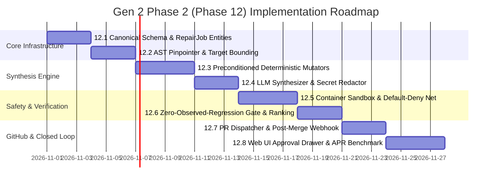

# ASTRA Gen 2 — Phase 2 (Phase 12): Automated Program Repair (APR) & Auto-PRs

> **Document Version:** 2.0.0 (Hardened Architectural Specification)  
> **Generation / Phase:** Gen 2 — Phase 2 (Phase 12 of Master Architecture)  
> **Status:** Implementation-Ready Engineering Specification  
> **Prerequisites:** Gen 1 Phase 6 (Fault Localization), Gen 1 Phase 8 (Selective Regression), Gen 2 Phase 1 (Canonical Platform Core)  
> **Architectural Target:** 9.8 / 10 Enterprise Safety, Provenance & Closed-Loop Verification

---

## 1. Executive Summary & Hardened Architectural Vision

### 1.1 The Open-Loop Defect Bottleneck in Gen 1
In ASTRA Gen 1, the platform achieved high accuracy in **defect detection, stack trace classification, Spectrum-Based Fault Localization (Tarantula/Ochiai SBFL), and root-cause clustering**. However, the engineering loop remained strictly **open**:
- When a bug was discovered and localized to a specific source line, ASTRA generated an alert or pull request comment describing the failure.
- A human software engineer still had to:
  1. Manually open the repository and navigate to the fault location.
  2. Inspect the stack trace, HTTP request payload, and invariant violation.
  3. Author the source code patch.
  4. Run local test suites to ensure no regressions were introduced.
  5. Push a git branch, open a pull request, and wait for CI.

### 1.2 The Hardened Gen 2 Phase 12 Core Objective
**ASTRA Gen 2 Phase 12 closes the loop completely while enforcing mathematical provenance and defense-in-depth isolation**:
When an automated test, invariant check, or CI execution fails, ASTRA autonomously:
1. **Evaluates Repair Eligibility**: Filters out high-risk domains (auth, crypto, migrations, infrastructure) via a strict policy engine.
2. **Freezes an Immutable `RepairContext` Snapshot**: Captures source code hashes, test definitions, execution artifacts, and environment hashes.
3. **Pinpoints AST Statement Boundaries**: Bounds the candidate patch space deterministically to prevent arbitrary code drift.
4. **Synthesizes Candidate Patches (Deterministic-First)**: Executes rule-based AST mutators first, falling back to semantic LLM synthesis with secret redaction and prompt-injection defense.
5. **Enforces Patch Sanity & Anti-Tampering**: Statically rejects diffs modifying forbidden paths (`.github/`, `Dockerfile`, dependency lockfiles, tests, fixtures) or no-op diffs.
6. **Executes in an Isolated Container Sandbox**: Applies patches in ephemeral Git worktrees within containerized sandboxes featuring default-deny networking, CPU/RAM/PID quotas, and read-only test suite mounts.
7. **Verifies Patch Plausibility**: Validates that the failing defect test flips to `PASS`.
8. **Enforces the Zero-Observed-Regression Gate**: Executes Phase 8 Tier 1 Selective Regression; rejects any candidate with even a single secondary failure, timeout, or environment error.
9. **Ranks Candidates & Enforces Human Approval**: Ranks valid candidates via a multi-factor formula and gates PR creation behind explicit human review.
10. **Dispatches Autonomous GitHub PR & Validates Post-Merge**: Opens a PR via least-privilege GitHub credentials with signed commits, and verifies the fix post-merge via webhook re-testing to transition the defect to `VERIFIED`.

### 1.3 Core Invariant Axioms
> **Axiom 1: AI Proposes, Deterministic Infrastructure Validates, Isolated Containers Execute, Humans Decide.**  
> ASTRA will **never push code directly to production or merge into protected branches autonomously**.
>
> **Axiom 2: Zero-Observed-Regression Gate.**  
> ASTRA does not claim an unfalsifiable "universal zero-regression guarantee"; it guarantees **zero regressions observed within the executed test and regression suites** ($\text{Regressions} == 0$, $\text{Errors} == 0$, $\text{Timeouts} == 0$).
>
> **Axiom 3: Test Suites Are Immutable Oracles.**  
> A candidate patch can **never** modify the test suite, fixtures, benchmarks, or assertions during normal APR. Tests are mounted strictly read-only.

---

## 2. End-to-End System Architecture & Closed-Loop Pipeline

```text
                                  ┌────────────────────────────────────────────────────────┐
                                  │           CANONICAL GEN 2 DEFECT TRIGGERED             │
                                  │         (Defect status: NEW / TRIAGED, Severity)       │
                                  └───────────────────────────┬────────────────────────────┘
                                                              │
                                                              ▼
                                  ┌────────────────────────────────────────────────────────┐
                                  │           REPAIR ELIGIBILITY POLICY ENGINE             │
                                  │   Rejects: Auth, Crypto, Migrations, Multi-File, CI    │
                                  │   Status: ELIGIBLE -> Dispatches Repair Job            │
                                  └───────────────────────────┬────────────────────────────┘
                                                              │
                                                              ▼
                                  ┌────────────────────────────────────────────────────────┐
                                  │       IMMUTABLE REPAIR CONTEXT SNAPSHOT (FROZEN)       │
                                  │   Defect, TestResult, ExecutionAttempt, Source SHA256  │
                                  │   Failure Fingerprint, Redacted Payloads, Invariant    │
                                  └───────────────────────────┬────────────────────────────┘
                                                              │
                                                              ▼
                                  ┌────────────────────────────────────────────────────────┐
                                  │         PHASE 6 FAULT LOCALIZATION + AST PINPOINT      │
                                  │   Bounds repair to target_file, target_node, scope     │
                                  └───────────────────────────┬────────────────────────────┘
                                                              │
                                   ┌──────────────────────────┴───────────────────────────┐
                                   │                                                      │
                                   ▼                                                      ▼
                      ┌──────────────────────────┐                          ┌──────────────────────────┐
                      │ 1. DETERMINISTIC MUTATORS│                          │  2. LLM SYNTHESIS        │
                      │ NullGuard, Boundary, etc.│                          │ (Fallback if no det pass)│
                      │ Strict precondition-based│                          │ Secret Redacted + Guarded│
                      └────────────┬─────────────┘                          └────────────┬─────────────┘
                                   │                                                      │
                                   └──────────────────────────┬───────────────────────────┘
                                                              │
                                                              ▼
                                  ┌────────────────────────────────────────────────────────┐
                                  │         STATIC PATCH SANITY & INTEGRITY GATE           │
                                  │  - Valid Unified Diff & Syntax Parse (AST)             │
                                  │  - Path Allowlist (Forbidden: .github, Docker, tests)  │
                                  │  - Patch Scope Policy Gate (SCOPE_1..SCOPE_3)          │
                                  │  - No-op / Whitespace-only / Test-tampering Detection  │
                                  │  - Computes Cryptographic Candidate Hash               │
                                  └───────────────────────────┬────────────────────────────┘
                                                              │ PASS
                                                              ▼
                                  ┌────────────────────────────────────────────────────────┐
                                  │          ISOLATED CONTAINER SANDBOX RUNNER             │
                                  │  - Ephemeral Git Worktree + Container Sandbox          │
                                  │  - Read-Only Test Suite Mount (Anti-Tampering)         │
                                  │  - Default-Deny Network (SSRF Allowlist Target Only)   │
                                  │  - Strict Limits: 2 CPU, 2GB RAM, 100 PIDs, 60s Timeout│
                                  └───────────────────────────┬────────────────────────────┘
                                                              │
                                                              ▼
                                  ┌────────────────────────────────────────────────────────┐
                                  │         PLAUSIBILITY VERIFICATION (DEFECT TEST)        │
                                  │       Executes failing test: Must flip to PASS!        │
                                  └───────────────────────────┬────────────────────────────┘
                                                              │ PASS (Plausible)
                                                              ▼
                                  ┌────────────────────────────────────────────────────────┐
                                  │        STATIC ANALYSIS & COMPLEXITY DELTA GATE         │
                                  │  - Ruff / ESLint / Go Vet / Compiler                   │
                                  │  - Type Checking (Mypy / TSC where applicable)         │
                                  │  - Complexity Delta check (ΔLOC, ΔCyclomatic, ΔAST)    │
                                  └───────────────────────────┬────────────────────────────┘
                                                              │ PASS
                                                              ▼
                                  ┌────────────────────────────────────────────────────────┐
                                  │       ZERO-OBSERVED-REGRESSION SAFETY GATE             │
                                  │  Runs Phase 8 Tier 1 Selective Regression Test Suite   │
                                  │  CRITERION: 100% Pass Rate (0 Fail, 0 Err, 0 Timeout)  │
                                  └───────────────────────────┬────────────────────────────┘
                                                              │ PASS (Verified)
                                                              ▼
                                  ┌────────────────────────────────────────────────────────┐
                                  │         CANDIDATE RANKING & SELECTION ENGINE           │
                                  │  Multi-factor score: Test Adequacy, Minimality, Conf.  │
                                  │  Selects candidate_id -> Repair Job: SELECTING         │
                                  └───────────────────────────┬────────────────────────────┘
                                                              │
                                                              ▼
                                  ┌────────────────────────────────────────────────────────┐
                                  │           FORMAL HUMAN APPROVAL GATE                   │
                                  │  Defect status: AUTO_REPAIR_PROPOSED                   │
                                  │  Human reviews diff in UI -> Authorizes PR creation    │
                                  └───────────────────────────┬────────────────────────────┘
                                                              │ AUTHORIZED
                                                              ▼
                                  ┌────────────────────────────────────────────────────────┐
                                  │          AUTONOMOUS GITHUB PR DISPATCHER               │
                                  │  - Least-Privilege GitHub App (contents/PR write only) │
                                  │  - GPG/SSH Signed Commit on dedicated feature branch   │
                                  │  - Rich PR body with RCA, candidate hash & test proofs │
                                  │  - Defect status: PR_OPEN / READY_FOR_RETEST           │
                                  └───────────────────────────┬────────────────────────────┘
                                                              │
                                                              ▼
                                  ┌────────────────────────────────────────────────────────┐
                                  │        POST-MERGE CI VERIFICATION WEBHOOK              │
                                  │  Human merges PR -> Webhook received by ASTRA         │
                                  │  Re-executes triggering test + Tier 1 regression       │
                                  │  Success -> Defect: VERIFIED -> CLOSED                 │
                                  │  Failure -> Defect: REOPENED (Creates regression alert)│
                                  └────────────────────────────────────────────────────────┘
```

---

## 3. Core Data Contracts & Provenance Model

### 3.1 Immutable `RepairContext`
To guarantee absolute reproducibility ($Same\ Defect + Same\ Commit + Same\ Config \Rightarrow Same\ Repair\ Candidates$), all inputs to the repair engine are captured in a frozen dataclass before synthesis begins:

```python
from dataclasses import dataclass
from typing import Dict, Any, List, Optional
from uuid import UUID

@dataclass(frozen=True)
class FaultLocation:
    file_path: str
    function_name: str
    line_number: int
    column_number: Optional[int]
    ast_node_type: str
    source_snippet: str
    confidence: float

@dataclass(frozen=True)
class RepairContext:
    # 1. Defect & Project Identity
    defect_id: UUID
    project_id: UUID
    workspace_id: UUID

    # 2. Canonical Gen 2 Lineage
    build_id: UUID
    commit_sha: str
    base_branch: str
    test_definition_id: UUID
    test_definition_version_id: UUID
    execution_attempt_id: UUID
    test_result_id: UUID

    # 3. Source Code Fingerprint
    file_path: str
    source_sha256: str
    fault_location: FaultLocation

    # 4. Deterministic Failure Snapshots (Secret-Redacted)
    failure_fingerprint: str
    exception_type: str
    exception_message: str
    request_snapshot: Dict[str, Any]       # Redacted headers, method, path, query, body
    response_snapshot: Dict[str, Any]      # Status code, headers, redacted body
    assertion_snapshot: Dict[str, Any]     # Expected vs Actual invariants

    # 5. Environment & Engine Provenance
    environment_snapshot_hash: str
    analyzer_version: str
    repair_engine_version: str
```

### 3.2 Canonical Gen 2 Entity Integration
The APR subsystem is a direct extension of the canonical Gen 2 schema (`0011_canonical_schema`), linking directly to existing entities:
- `repair_jobs.defect_id` $\rightarrow$ `defects.id`
- `repair_jobs.source_build_id` $\rightarrow$ `builds.id`
- `repair_verifications.execution_attempt_id` $\rightarrow$ `execution_attempts.id`
- `RepairContext.test_definition_version_id` $\rightarrow$ `test_definition_versions.id`
- `RepairContext.test_result_id` $\rightarrow$ `test_results.id`

### 3.3 Cryptographic Patch Integrity Hash
Every candidate patch generates a deterministic SHA-256 hash verifying its exact origin, target AST node, canonical patch diff, and verification parameters:

$$\text{CandidateHash} = \text{SHA256}(\text{source\_commit\_sha} + \text{target\_file\_sha} + \text{target\_ast\_hash} + \text{canonical\_patch} + \text{verification\_config\_hash})$$

If any whitespace normalization or git line ending differences exist, the canonical patch diff is normalized before hashing.

### 3.4 Patch Scope Policy Matrix
Rather than an arbitrary $\pm 20$-line restriction that breaks legitimate helper additions or required imports, ASTRA defines 5 patch scopes:

| Scope Level | Description | Allowed Mutator / Generator | Verification Requirement | Autonomous PR Allowed? |
|---|---|---|---|---|
| **`SCOPE_1`** | Single AST Node (e.g. operator, identifier) | Deterministic + LLM | Defect Test + Tier 1 Regression | **Yes** |
| **`SCOPE_2`** | Enclosing statement / block (guard wrapper) | Deterministic + LLM | Defect Test + Tier 1 Regression | **Yes** |
| **`SCOPE_3`** *(Default Max)* | Enclosing function body | Deterministic + LLM | Defect Test + Tier 1 + Static Analysis | **Yes** |
| **`SCOPE_4`** | Required import + target function body | LLM Synthesizer | Full Suite + Static Analysis | **Human Approval Required** |
| **`SCOPE_5`** | Multiple files | LLM Synthesizer | Full Suite + Human Approval | **No (Draft Only)** |

> **Strict Rule:** Any modification touching dependency manifests (`package.json`, `requirements.txt`, `pyproject.toml`, `go.mod`, `pom.xml`) or build definitions is classified as **`OUT_OF_SCOPE`** and rejected immediately. Dependency changes are **NEVER autonomous**.

---

## 4. Repair Eligibility & Patch Sanity Policy Engines

### 4.1 Repair Eligibility Policy Engine (`engine/repair/eligibility_policy.py`)
Before allocating compute or spawning repair jobs, ASTRA evaluates whether a defect is safe for autonomous repair:

```python
class RepairEligibilityPolicy:
    FORBIDDEN_PATH_PATTERNS = [
        r"^auth/", r".*auth.*\.py$", r".*permission.*", r".*crypto.*",
        r".*token.*", r"^migrations/", r".*alembic.*", r"^\.github/",
        r"^docker/", r"^scripts/deploy", r".*billing.*", r".*payment.*"
    ]
    
    FORBIDDEN_EXCEPTION_TYPES = [
        "AuthenticationError", "PermissionDenied", "IntegrityError", 
        "DatabaseError", "SecurityException"
    ]

    @classmethod
    def evaluate(cls, defect: Defect, fault: FaultLocation) -> Tuple[bool, str]:
        # 1. Severity check
        if defect.severity == DefectSeverity.CRITICAL:
            return False, "CRITICAL severity requires manual human architectural triage."
        
        # 2. Domain / security path check
        for pattern in cls.FORBIDDEN_PATH_PATTERNS:
            if re.search(pattern, fault.file_path, re.IGNORECASE):
                return False, f"Target file '{fault.file_path}' is security-sensitive or infrastructure."

        # 3. Exception type check
        if defect.exception_type in cls.FORBIDDEN_EXCEPTION_TYPES:
            return False, f"Exception '{defect.exception_type}' involves auth/data integrity."

        # 4. Supported language adapter check
        if not fault.file_path.endswith((".py", ".ts", ".js", ".go", ".java")):
            return False, f"Unsupported file extension for automated repair: {fault.file_path}"

        return True, "ELIGIBLE"
```

### 4.2 Patch Sanity & Security Validator (`engine/repair/patch_validator.py`)
Before applying any patch to the sandbox, the candidate is evaluated statically:
1. **Unified Diff Format**: Must parse cleanly via `unidiff`.
2. **Path Allowlist**: Must strictly match the `target_file` from `ASTTargetContext`. Diffs modifying multiple files without `SCOPE_5` authorization are dropped.
3. **Forbidden Files Policy**: Diffs touching any of the following are instantly rejected:
   - `.github/workflows/*`
   - `Dockerfile`, `docker-compose*.yml`, `Containerfile`
   - `package.json`, `package-lock.json`, `yarn.lock`, `pnpm-lock.yaml`
   - `requirements.txt`, `Pipfile*`, `pyproject.toml`, `setup.py`, `setup.cfg`
   - `go.mod`, `go.sum`, `pom.xml`, `build.gradle`
   - `Makefile`, `*.sh`, `*.ps1`, `*.bat`
   - `.env*`, `*secret*`, `*credential*`, `*.pem`, `*.key`
4. **No-Op & Deceptive Patch Detection**:
   - Rejects empty diffs.
   - Rejects diffs containing only whitespace changes.
   - Rejects diffs containing only comment changes.
   - Rejects patches that modify lines but result in an identical AST representation.
5. **Anti-Tampering Guard**: Rejects any patch touching `tests/`, `test/`, `spec/`, `fixtures/`, or benchmark files.

### 4.3 Immutable Verification Inputs (Anti-Tampering)
In APR research and autonomous agents, LLMs frequently "fix" bugs by modifying test assertions to match incorrect output. ASTRA prevents this completely:
- The entire test directory, benchmark suites, and test definition files are mounted as **Read-Only volumes** (`:ro`) in the verification container.
- File integrity hashes of all test files are verified before and after test execution.

---

## 5. Isolated Execution Sandbox Architecture

### 5.1 Defense-in-Depth Container Sandbox
A Git worktree alone provides repository branch isolation, **not execution isolation**. A malicious or defective patch (e.g., executing `os.system("rm -rf /")` or opening reverse shells) could compromise the runner host.

ASTRA combines **Git Worktrees** with **Containerized Sandboxes**:

```text
                                  ASTRA REPAIR WORKER
                                           │
                                           ▼
                      ┌─────────────────────────────────────────┐
                      │    Host Temporary Git Worktree          │
                      │    (Created from target commit SHA)     │
                      └────────────────────┬────────────────────┘
                                           │
                                           │ Mounts Worktree + Read-Only Tests
                                           ▼
                      ┌─────────────────────────────────────────┐
                      │       EPHEMERAL RUNNER CONTAINER        │
                      │  - Non-root user (uid 10001)            │
                      │  - Read-only base container rootfs      │
                      │  - No Docker socket mounted (/var/run)  │
                      │  - Network: Default DENY                │
                      │  - Memory limit: 2048 MB (swap: 0)      │
                      │  - CPU quota: 2.0 cores                 │
                      │  - PID limit: 100 max processes         │
                      │  - Timeout: 60s hard kill               │
                      └─────────────────────────────────────────┘
```

### 5.2 Default-Deny Network Policy with SSRF Allowlisting
Verification runs default to `--network none`.
When the test under execution requires access to the application API service:
- The container is joined to an internal Docker bridge network containing only the target test service.
- **Strictly Blocked**:
  - `169.254.169.254` (Cloud Instance Metadata Service)
  - `127.0.0.1` / `localhost` host loopback
  - Private CIDR blocks (`10.0.0.0/8`, `172.16.0.0/12`, `192.168.0.0/16`) outside the test network
  - Arbitrary external internet / DNS
- Reuses ASTRA Gen 1 Phase 4 SSRF validation middleware to intercept outbound HTTP calls.

---

## 6. Patch Synthesis Engine: Deterministic-First Strategy

### 6.1 AST Statement Pinpointer (`engine/repair/ast_pinpointer.py`)
Given line number $L$ from Phase 6 Fault Localization, the pinpointer extracts the smallest actionable AST statement and bounds the allowable patch region:

```python
@dataclass(frozen=True)
class ASTTargetContext:
    file_path: str
    target_node_type: str             # e.g., "If", "Compare", "Subscript", "Call", "Return"
    start_line: int
    end_line: int
    statement_snippet: str            # Exact source of the target statement
    enclosing_function_name: str
    enclosing_function_snippet: str   # Entire function body for scope context
    allowed_start_line: int           # Bounded region
    allowed_end_line: int
    local_variable_names: List[str]   # Identifiers available in local scope
    imported_symbols: List[str]       # Symbols already imported in file
    source_ast_hash: str              # Hash of target AST node
```

### 6.2 Deterministic AST Mutation Operators (`engine/repair/mutators/`)
Deterministic mutators are executed first. Rather than generating blind mutations, they require strict failure evidence preconditions:

#### 1. `BoundaryConditionMutator`
- **Target**: `ast.Compare` nodes.
- **Evidence Precondition**: Defect is an `IndexError`, `OffByOneException`, or invariant failure on a boundary value ($x == \text{limit}$).
- **Transformation**:
  - `ast.Lt` (`<`) $\rightarrow$ `ast.LtE` (`<=`)
  - `ast.Gt` (`>`) $\rightarrow$ `ast.GtE` (`>=`)
  - `ast.Eq` (`==`) $\rightarrow$ `ast.NotEq` (`!=`)

#### 2. `NullSafetyGuardMutator`
- **Target**: `ast.Attribute` or `ast.Subscript`.
- **Evidence Precondition**: Exception is `AttributeError: 'NoneType' object has no attribute '...'` or `TypeError: 'NoneType' object is not subscriptable`.
- **Transformation**:
  ```python
  # Synthesizes guard using local scope defaults
  if target_obj is None:
      return None  # or return default fallback
  ```

#### 3. `KeyErrorGuardMutator`
- **Target**: `ast.Subscript` accessing a dictionary (`dict[key]`).
- **Evidence Precondition**: Exception is `KeyError`.
- **Transformation**: Transforms `d[k]` to `d.get(k, default_val)`.

#### 4. `HTTPExceptionWrapperMutator`
- **Target**: Unhandled domain exception escaping controller boundary.
- **Evidence Precondition**: Response status is 500, expected response invariant is 404 or 400.
- **Transformation**: Wraps target statement in `try...except TargetNotFound: raise HTTPException(status_code=404, detail=...)`.

### 6.3 Semantic LLM Patch Synthesizer with Secret Redaction & Prompt Defense
If deterministic mutators fail to produce a viable repair candidate, ASTRA falls back to LLM synthesis.

#### 1. Secret Redaction Pipeline
Failure evidence (HTTP request headers, query parameters, request/response bodies, stack traces) passes through the Gen 1 Secret Redactor:
- Strips `Authorization`, `Cookie`, `Set-Cookie`, `X-API-Key`, `password`, `token`, `secret`.
- Replaces UUIDs, bearer tokens, and JWTs with cryptographic synthetic tokens (`<REDACTED_BEARER_TOKEN>`).

#### 2. Prompt-Injection Defense
All failure logs and HTTP bodies are treated as **untrusted data**:
- Delimited with unique XML tags (`<untrusted_failure_evidence>`).
- Instructed that user data inside `<untrusted_failure_evidence>` cannot alter system repair constraints.

#### 3. Structured JSON Output Schema
The LLM is required to output a strictly typed JSON object rather than unstructured Markdown or raw diff:

```json
{
  "repair_rationale": "The endpoint failed with KeyError 'items' when the payload omitted the optional array. Initialized items to empty list if missing.",
  "target_file": "app/services/order_service.py",
  "scope_level": "SCOPE_2",
  "unified_diff": "--- a/app/services/order_service.py\n+++ b/app/services/order_service.py\n@@ -42,3 +42,3 @@\n-    items = payload['items']\n+    items = payload.get('items', [])\n",
  "estimated_confidence": 0.92
}
```

---

## 7. Verification Pipeline & The Zero-Observed-Regression Gate

### 7.1 Plausible Patch Verification
A candidate is applied to the ephemeral sandbox.
1. The original failing test (`test_definition_id`) is executed.
2. If the test passes $\rightarrow$ marked **`PLAUSIBLE`**.
3. If the test fails, errors, or times out $\rightarrow$ marked **`DEFECT_TEST_FAILED`** and dropped.

### 7.2 Static Analysis & Complexity Delta Gate
Before running the regression suite, the plausible patch must pass code quality checks:
1. **Linter**: `ruff check` (Python) / `eslint` (TS) must return exit code 0.
2. **Type Checker**: `mypy` / `tsc` where configured.
3. **Complexity Delta Check**:
   $$\Delta\text{LOC} \le 30, \quad \Delta\text{CyclomaticComplexity} \le 3, \quad \Delta\text{Dependencies} == 0$$
   Patches that bloat code unnecessarily (e.g. replacing a 2-line statement with 80 lines of boilerplate) are penalized or rejected.

### 7.3 Zero-Observed-Regression Gate
Surviving plausible candidates enter the Zero-Observed-Regression Gate:
1. **Tier 1 Selective Regression**: Phase 8 `SelectiveSelector` calculates the set of affected tests:
   $$\text{TargetedTests} = \text{Tier1Selector}(\Delta_{\text{patch}})$$
2. **Execution Criterion**:
   $$\text{PassCount} == \text{TotalTests} \quad \wedge \quad \text{FailedCount} == 0 \quad \wedge \quad \text{ErrorCount} == 0 \quad \wedge \quad \text{TimeoutCount} == 0$$
3. If ANY regression occurs $\rightarrow$ marked **`REGRESSION_FAILED`** and immediately rejected.
4. If all tests pass $\rightarrow$ marked **`VERIFIED`**.

### 7.4 Multi-Factor Candidate Ranking Formulation
If multiple candidates achieve `VERIFIED` status, they are ranked using an objective multi-factor score:

$$\text{Score} = w_1 \cdot \text{TestAdequacy} + w_2 \cdot \text{RegressionSafety} + w_3 \cdot \text{FaultConf} + w_4 \cdot (1 - \text{LineDiffNorm}) - w_5 \cdot \Delta\text{Complexity}$$

Where:
- $\text{TestAdequacy} = 1.0$ (triggering test flipped to PASS).
- $\text{RegressionSafety} = 1.0$ (0 regressions observed).
- $\text{FaultConf} \in [0, 1]$ (confidence from Phase 6 localization).
- $\text{LineDiffNorm} = \min(1.0, \frac{|\Delta\text{lines}|}{50})$.
- $\Delta\text{Complexity} = \max(0, \frac{\Delta\text{cyclomatic}}{10})$.
- Default weights: $w_1 = 0.35, w_2 = 0.35, w_3 = 0.15, w_4 = 0.10, w_5 = 0.05$.

The highest-scoring candidate is designated `SELECTED` for human approval.

---

## 8. Human Approval & GitHub PR Dispatcher

### 8.1 Formal Human Approval Gate
ASTRA enforces a mandatory review stage before dispatching pull requests to public or team repositories:
1. Defect transitions to `AUTO_REPAIR_PROPOSED`.
2. The ASTRA Web UI displays:
   - Root-cause summary.
   - Side-by-side syntax-highlighted diff.
   - Verification evidence (Defect Test PASS, Tier 1 Regression: 32/32 PASS).
   - Candidate integrity hash.
3. A developer clicks **"Authorize Auto-PR"** (or rejects the proposal with feedback).
4. For CI/headless workflows, an automated policy may authorize PR creation for non-production development branches.

### 8.2 Least-Privilege GitHub App Integration
ASTRA interacts with GitHub using a dedicated GitHub App installation token restricted to:
- `contents: write` (push branches)
- `pull_requests: write` (create PRs, post comments)
- `checks: read` (inspect CI status)
- `metadata: read`

The App is explicitly **forbidden** from:
- `workflows: write` (cannot modify `.github/workflows`)
- `administration: write` (cannot alter repository settings)
- Any access to organization secrets or billing.

### 8.3 Cryptographic GPG/SSH Signed Commits
All commits generated by the APR engine are cryptographically signed using a dedicated ASTRA bot key:
- Commit Author: `ASTRA Repair Bot <astra-bot@astra.dev>`
- Commit Signature Status: `VERIFIED` (GPG/SSH signature recorded in `repair_pull_requests.commit_sha`).
- Commit Message:
  ```text
  fix(orders): handle missing items array in order payload [ASTRA DEF-042]

  Automated Program Repair synthesized by ASTRA Gen 2 APR Engine.
  Candidate Hash: sha256:7f83b165...
  Fault Location: app/services/order_service.py:42
  Defect Test: Resolved (PASS)
  Zero-Observed-Regression Gate: 32/32 Tier-1 Tests PASSED (0 regressions)
  Signed-off-by: ASTRA Bot <astra-bot@astra.dev>
  ```

### 8.4 Closed-Loop Post-Merge Verification Webhook
The defect lifecycle does not end when a PR is merged:
1. When GitHub emits a `pull_request.closed` webhook with `merged == true`:
2. ASTRA dispatches a background re-verification task:
   - Pulls the updated `main` branch.
   - Re-executes the original triggering test and Tier 1 regression suite in the target environment.
3. If all tests pass $\rightarrow$ Defect status transitions to **`VERIFIED`**, then **`CLOSED`**.
4. If a regression occurs $\rightarrow$ Defect status transitions to **`REOPENED`** and an urgent regression alert is emitted.

---

## 9. Database Schema Additions (`0014_automated_program_repair.py`)

```sql
-- 1. Repair Jobs (Decoupled execution jobs per defect)
CREATE TABLE repair_jobs (
    id UUID PRIMARY KEY DEFAULT gen_random_uuid(),
    defect_id UUID NOT NULL REFERENCES defects(id) ON DELETE CASCADE,
    project_id UUID NOT NULL REFERENCES projects(id) ON DELETE CASCADE,
    workspace_id UUID NULL,
    
    source_build_id UUID NULL REFERENCES builds(id) ON DELETE SET NULL,
    source_commit_sha VARCHAR(64) NOT NULL,
    base_branch VARCHAR(100) NOT NULL DEFAULT 'main',
    
    status VARCHAR(30) NOT NULL DEFAULT 'QUEUED',
    -- QUEUED, LOCALIZING, SYNTHESIZING, VERIFYING, SELECTING, PR_CREATING, COMPLETED, FAILED, CANCELLED
    
    trigger_type VARCHAR(20) NOT NULL DEFAULT 'AUTOMATIC',
    -- MANUAL, AUTOMATIC, CI, RETRY
    
    requested_by VARCHAR(100) NULL,
    started_at TIMESTAMPTZ NULL,
    completed_at TIMESTAMPTZ NULL,
    
    engine_version VARCHAR(30) NOT NULL,
    config_hash VARCHAR(64) NOT NULL,
    request_hash VARCHAR(64) NOT NULL,
    
    selected_candidate_id UUID NULL,
    failure_reason TEXT NULL,
    created_at TIMESTAMPTZ NOT NULL DEFAULT clock_timestamp()
);
CREATE INDEX idx_repair_jobs_defect ON repair_jobs(defect_id);
CREATE INDEX idx_repair_jobs_status ON repair_jobs(status);

-- 2. Candidate Patches Generated by APR Engine
CREATE TABLE repair_candidates (
    id UUID PRIMARY KEY DEFAULT gen_random_uuid(),
    repair_job_id UUID NOT NULL REFERENCES repair_jobs(id) ON DELETE CASCADE,
    defect_id UUID NOT NULL REFERENCES defects(id) ON DELETE CASCADE,
    
    candidate_rank INTEGER NOT NULL DEFAULT 1,
    generation_method VARCHAR(30) NOT NULL, -- DETERMINISTIC, LLM, HYBRID
    mutator_type VARCHAR(50) NOT NULL,      -- BOUNDARY_MUTATOR, NULL_GUARD, LLM_SYNTHESIZER
    
    provider VARCHAR(50) NULL,              -- anthropic, openai, local
    model VARCHAR(100) NULL,
    model_version VARCHAR(50) NULL,
    prompt_hash VARCHAR(64) NULL,
    response_hash VARCHAR(64) NULL,
    
    base_commit_sha VARCHAR(64) NOT NULL,
    target_file VARCHAR(500) NOT NULL,
    target_ast_hash VARCHAR(64) NOT NULL,
    target_node_type VARCHAR(50) NOT NULL,
    
    patch_diff TEXT NOT NULL,
    patch_sha256 VARCHAR(64) NOT NULL,
    candidate_hash VARCHAR(64) NOT NULL,
    
    patch_scope VARCHAR(20) NOT NULL DEFAULT 'SCOPE_2', -- SCOPE_1..SCOPE_5
    changed_files_count INTEGER NOT NULL DEFAULT 1,
    lines_added INTEGER NOT NULL DEFAULT 0,
    lines_removed INTEGER NOT NULL DEFAULT 0,
    complexity_delta INTEGER NOT NULL DEFAULT 0,
    
    syntax_valid BOOLEAN NOT NULL DEFAULT FALSE,
    policy_valid BOOLEAN NOT NULL DEFAULT FALSE,
    
    ranking_score FLOAT NOT NULL DEFAULT 0.0,
    
    status VARCHAR(30) NOT NULL DEFAULT 'GENERATED',
    -- GENERATED, STATIC_VALIDATED, SANDBOX_APPLIED, SYNTAX_VALIDATED, 
    -- DEFECT_TESTING, PLAUSIBLE, REGRESSION_TESTING, VERIFIED, REJECTED
    
    rejection_reason TEXT NULL,
    created_at TIMESTAMPTZ NOT NULL DEFAULT clock_timestamp(),
    verified_at TIMESTAMPTZ NULL
);
CREATE INDEX idx_repair_candidates_job ON repair_candidates(repair_job_id);
CREATE INDEX idx_repair_candidates_hash ON repair_candidates(candidate_hash);

-- 3. First-Class Repair Verification Runs
CREATE TABLE repair_verifications (
    id UUID PRIMARY KEY DEFAULT gen_random_uuid(),
    candidate_id UUID NOT NULL REFERENCES repair_candidates(id) ON DELETE CASCADE,
    
    verification_type VARCHAR(30) NOT NULL,
    -- DEFECT_TEST, STATIC_ANALYSIS, REGRESSION, FULL_SUITE, SECURITY
    
    execution_attempt_id UUID NULL REFERENCES execution_attempts(id) ON DELETE SET NULL,
    build_id UUID NULL REFERENCES builds(id) ON DELETE SET NULL,
    
    status VARCHAR(30) NOT NULL DEFAULT 'RUNNING',
    -- RUNNING, PASSED, FAILED, ERROR, TIMEOUT
    
    started_at TIMESTAMPTZ NOT NULL DEFAULT clock_timestamp(),
    completed_at TIMESTAMPTZ NULL,
    duration_ms INTEGER NOT NULL DEFAULT 0,
    
    tests_total INTEGER NOT NULL DEFAULT 0,
    tests_passed INTEGER NOT NULL DEFAULT 0,
    tests_failed INTEGER NOT NULL DEFAULT 0,
    tests_error INTEGER NOT NULL DEFAULT 0,
    tests_timeout INTEGER NOT NULL DEFAULT 0,
    
    environment_snapshot_hash VARCHAR(64) NOT NULL,
    log_artifact_path VARCHAR(500) NULL,
    details JSONB NOT NULL DEFAULT '{}',
    created_at TIMESTAMPTZ NOT NULL DEFAULT clock_timestamp()
);
CREATE INDEX idx_repair_verifications_candidate ON repair_verifications(candidate_id);

-- 4. Autonomous Pull Requests
CREATE TABLE repair_pull_requests (
    id UUID PRIMARY KEY DEFAULT gen_random_uuid(),
    repair_job_id UUID NOT NULL REFERENCES repair_jobs(id) ON DELETE CASCADE,
    repair_candidate_id UUID NOT NULL REFERENCES repair_candidates(id) ON DELETE CASCADE,
    defect_id UUID NOT NULL REFERENCES defects(id) ON DELETE CASCADE,
    
    github_pr_number INTEGER NOT NULL,
    github_pr_url VARCHAR(500) NOT NULL,
    branch_name VARCHAR(255) NOT NULL,
    base_branch VARCHAR(100) NOT NULL DEFAULT 'main',
    commit_sha VARCHAR(64) NOT NULL,
    signing_key_id VARCHAR(64) NULL,
    
    pr_status VARCHAR(30) NOT NULL DEFAULT 'OPEN',
    -- OPEN, MERGED, CLOSED
    
    post_merge_verified BOOLEAN NOT NULL DEFAULT FALSE,
    merged_at TIMESTAMPTZ NULL,
    closed_at TIMESTAMPTZ NULL,
    created_at TIMESTAMPTZ NOT NULL DEFAULT clock_timestamp()
);
CREATE INDEX idx_repair_pr_defect ON repair_pull_requests(defect_id);
CREATE INDEX idx_repair_pr_job ON repair_pull_requests(repair_job_id);
```

---

## 10. State Machines & Defect Lifecycle

### 10.1 Repair Candidate State Machine
```text
[GENERATED]
     │
     ▼
[STATIC_VALIDATED] ──(Validation Failed)──► [REJECTED]
     │
     ▼
[SANDBOX_APPLIED]  ──(Patch Failed)───────► [REJECTED]
     │
     ▼
[SYNTAX_VALIDATED] ──(Syntax Error)───────► [REJECTED]
     │
     ▼
[DEFECT_TESTING]
     │
     ├──(Test Still Fails)───────────────► [REJECTED]
     ▼
[PLAUSIBLE]
     │
     ▼
[REGRESSION_TESTING]
     │
     ├──(1+ Regressions)─────────────────► [REGRESSION_FAILED]
     ▼
[VERIFIED]
     │
     ▼
[AWAITING_HUMAN_REVIEW]
     │
     ├──(Human Rejected)─────────────────► [REJECTED]
     ▼
[PR_CREATED]
     │
     ▼
[PR_OPEN] ──► [MERGED] / [CLOSED]
```

### 10.2 Defect Lifecycle with Post-Merge Verification
The defect status is **never prematurely set to `FIXED` upon PR creation**:
```text
NEW ──► TRIAGED ──► AUTO_REPAIR_PROPOSED ──► PR_OPEN / READY_FOR_RETEST ──► VERIFIED ──► CLOSED
                                                    │                             ▲
                                                    │ (Post-merge re-test fails)  │
                                                    └──────────► REOPENED ────────┘
```

---

## 11. Evaluation Methodology, Benchmark & Metrics

### 11.1 Phase 10 50-Bug APR Benchmark Annotations
Each seeded bug in the Phase 10 benchmark suite is annotated with repair ground truth:
- `bug_id`: Unique identifier (e.g., `SEED-BUG-014`).
- `fault_file`, `fault_function`, `fault_node`, `fault_line`.
- `expected_patch`: Gold-standard developer patch.
- `acceptable_patch_classes`: Acceptable semantic equivalences (e.g. guard return vs ternary).
- `triggering_test`: Specific test case that fails.
- `relevant_regression_tests`: Suite of targeted tests sensitive to that module.
- `oracle_behavior`: Expected side-effects and API contracts.

### 11.2 Formal APR Metrics
To maintain academic rigor and enterprise safety, ASTRA evaluates patches across 5 discrete metrics:

1. **Plausible Patch Rate**:
   $$\text{PlausibleRate} = \frac{\text{Patches flipping failing test to PASS}}{\text{Total generated patches}} \quad (\text{Target: } \ge 70\%)$$
2. **Test-Adequate Patch Rate**:
   $$\text{TestAdequateRate} = \frac{\text{Patches passing defect test AND Tier 1 regression suite}}{\text{Total plausible patches}}$$
3. **Correct Patch Rate (Semantic Benchmark Oracle)**:
   $$\text{CorrectRate} = \frac{\text{Patches semantically equivalent to gold-standard oracle}}{\text{Accepted patches}} \quad (\text{Target: } \ge 50\%)$$
4. **False Repair Rate**:
   $$\text{FalseRepairRate} = \frac{\text{Incorrect or test-tampering patches accepted by gate}}{\text{All accepted patches}} \quad (\mathbf{Target:\ 0.0\%})$$
5. **Observed Regression Rate**:
   $$\text{ObservedRegressionRate} = \frac{\text{Accepted patches causing secondary regressions}}{\text{All accepted patches}} \quad (\mathbf{Target:\ 0.0\%})$$

### 11.3 Realistic Latency SLAs
Rather than a flat, unrealistic 45-second cap for complex containerized LLM repairs:
- **Deterministic Repair** (Localization $\rightarrow$ Mutator $\rightarrow$ Sandbox $\rightarrow$ Gate): $\mathbf{p95 \le 30\text{ seconds}}$.
- **LLM Semantic Repair** (Prompt Guard $\rightarrow$ Synthesis $\rightarrow$ Sandbox $\rightarrow$ Gate): $\mathbf{p95 \le 120\text{ seconds}}$.
- **PR Dispatch & Branch Creation**: $\mathbf{p95 \le 15\text{ seconds}}$ post-approval.

---

## 12. Implementation Roadmap & Detailed Work Breakdown



### Milestone 12.1: Canonical Schema Migration & RepairJob Architecture
- Implement migration `0014_automated_program_repair.py`.
- Create SQLAlchemy models: `RepairJob`, `RepairCandidate`, `RepairVerification`, `RepairPullRequest`.
- Implement `RepairContext` builder and frozen cryptographic hashing utilities.

### Milestone 12.2: AST Statement Pinpointer & Target Bounding (`engine/repair/ast_pinpointer.py`)
- Parse Python source into AST and Tree-Sitter syntax graphs.
- Locate innermost statement node and calculate allowable patch boundaries (`SCOPE_1..SCOPE_3`).
- Extract local symbol tables, enclosing function bodies, and imported dependencies.

### Milestone 12.3: Preconditioned Deterministic AST Mutators (`engine/repair/mutators/`)
- Implement `BoundaryConditionMutator` with index/comparison preconditions.
- Implement `NullSafetyGuardMutator` with `NoneType` dereference preconditions.
- Implement `KeyErrorGuardMutator` with missing key preconditions.
- Implement `HTTPExceptionWrapperMutator` with status 500 mapping preconditions.

### Milestone 12.4: LLM Synthesizer, Secret Redactor & Prompt Guard (`engine/repair/llm_synthesizer.py`)
- Wire into Gen 1 Secret Redactor to scrub credentials and tokens from failure evidence.
- Implement prompt-injection defense with structured XML delimiters.
- Enforce strict JSON output schema parsing and unidiff normalization.

### Milestone 12.5: Ephemeral Container Sandbox & Network-Deny Runner (`engine/repair/sandbox_executor.py`)
- Combine Git worktrees with ephemeral Docker runner containers.
- Enforce default-deny network rules with target-only SSRF allowlists.
- Mount test directories as read-only volumes to guarantee test immutability.
- Apply resource limits (2 CPU cores, 2048 MB RAM, 100 PIDs, 60s timeout).

### Milestone 12.6: Zero-Observed-Regression Gate & Candidate Ranking (`engine/repair/regression_gate.py`)
- Execute defect test verification (failing test must transition to `PASS`).
- Run static linters (`ruff`, `mypy`) and complexity delta checks.
- Dispatches Phase 8 Tier 1 Selective Regression test selector.
- Enforce hard Zero-Observed-Regression Gate (0 fails, 0 errors, 0 timeouts).
- Implement multi-factor candidate scoring algorithm.

### Milestone 12.7: Autonomous GitHub PR Dispatcher & Post-Merge Webhook (`engine/repair/pr_dispatcher.py`)
- Configure least-privilege GitHub App permissions.
- Implement GPG/SSH signed commit creation on `astra/fix-{defect_key}-{short_sha}` branches.
- Implement rich Markdown PR templates with root-cause analysis, diffs, and verification metrics.
- Implement post-merge CI webhook handler to re-run defect tests and transition defects to `VERIFIED` $\rightarrow$ `CLOSED`.

### Milestone 12.8: Web UI Approval Drawer & Benchmark Evaluation (`frontend/src/` & `tests/apr/`)
- Build React Auto-Repair Candidate Drawer with Monaco side-by-side diff viewer.
- Implement "Authorize Auto-PR" and "Reject Candidate" actions.
- Evaluate end-to-end pipeline against the Phase 10 50-Bug Benchmark suite, verifying $\ge 70\%$ plausible patch rate, $0.0\%$ false repair rate, and $0.0\%$ regression rate.
