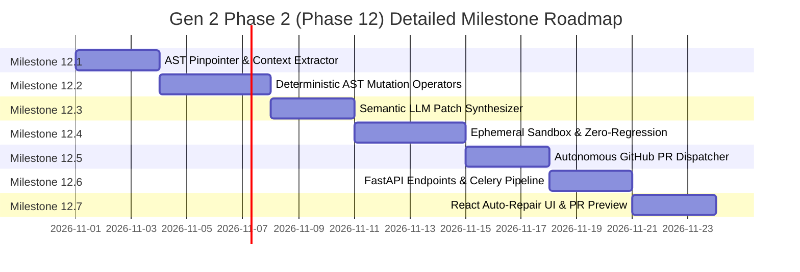

# ASTRA Gen 2 — Phase 2 (Phase 12): Automated Program Repair (APR) & Auto-PRs

> **Module Focus:** AST-Level Statement Localization, Rule-Based & LLM-Guided Patch Synthesis, Sandboxed Patch Verification, Zero-Regression Gate, and Autonomous GitHub Pull Request Dispatching.  
> **Generation / Phase:** Gen 2 — Phase 2 (Phase 12 of Master Architecture)  
> **Status:** Detailed Implementation Plan & Architecture Specification  
> **Prerequisites:** Gen 1 Phase 6 (Fault Localization), Gen 1 Phase 8 (Selective Regression), Gen 2 Phase 1 (Canonical Platform Core)  

---

## 1. Executive Summary & Problem Statement

### 1.1 The Open-Loop Defect Bottleneck in Gen 1
In ASTRA Gen 1, the platform successfully achieved high accuracy in **defect detection, stack trace classification, Spectrum-Based Fault Localization (Tarantula/Ochiai SBFL), and root-cause clustering**. However, the engineering loop remained **open**:
- When a bug was discovered and attributed to a specific source line, ASTRA generated an alert or PR comment explaining the failure.
- A human software engineer still had to:
  1. Manually open the repository and navigate to the fault location.
  2. Inspect the stack trace, HTTP request payload, and invariant violation.
  3. Author the source code patch.
  4. Run local test suites to ensure no regressions were introduced.
  5. Push a git branch, open a pull request, and wait for CI.

### 1.2 The Gen 2 Phase 2 Core Objective
**ASTRA Gen 2 Phase 12 closes the loop completely**:
When an automated test, invariant check, or CI execution fails, ASTRA autonomously:
1. **Pinpoints the exact AST statement node** responsible for the failure.
2. **Synthesizes candidate source code patches** using both deterministic AST mutation operators and semantic LLM synthesis.
3. **Applies the candidate patches in an isolated sandbox environment**.
4. **Validates that the failing test turns to PASS**.
5. **Enforces the Zero-Regression Gate** by running the Phase 8 Tier 1 Selective Regression suite (rejecting any patch that causes even a single secondary failure).
6. **Creates a git branch, commits the fix, and opens an autonomous GitHub Pull Request** complete with root-cause explanation, before-and-after diff, and verification evidence.

### 1.3 The Non-Negotiable Human-in-the-Loop Safety Invariant
> **AI Proposes $\rightarrow$ Sandbox Verifies $\rightarrow$ Zero-Regression Gate Validates $\rightarrow$ Human Reviews & Merges.**
>
> ASTRA will **never push code directly to production or merge into the `main` branch autonomously**. It creates isolated pull requests on dedicated feature branches (`astra/fix-{defect_key}-{short_sha}`) with complete cryptographic auditability, leaving the final merge authority strictly in human engineering hands.

---

## 2. End-to-End System Architecture & Data Flow

```text
                                  ┌────────────────────────────────────────────────────────┐
                                  │           EXECUTION PLANE (TEST FAILURE OBSERVED)      │
                                  │     Failing TestResult (Status 500, Invariant Failed)  │
                                  └───────────────────────────┬────────────────────────────┘
                                                              │
                                                              ▼
                                  ┌────────────────────────────────────────────────────────┐
                                  │         PHASE 6 ROOT CAUSE & FAULT LOCALIZATION        │
                                  │      Normalized Stack Frames • PKG Graph Traversal     │
                                  │         -> FaultLocation (File, Function, Line)        │
                                  └───────────────────────────┬────────────────────────────┘
                                                              │
                                                              ▼
                                  ┌────────────────────────────────────────────────────────┐
                                  │         AST STATEMENT PINPOINTER (MILESTONE 12.1)      │
                                  │   Locates exact AST Node: If, BinaryOp, Subscript, Call │
                                  │       Extracts Enclosing Block & Local Scope Context   │
                                  └───────────────────────────┬────────────────────────────┘
                                                              │
                                                              ▼
                                  ┌────────────────────────────────────────────────────────┐
                                  │         HYBRID PATCH SYNTHESIZER (MILESTONE 12.2-12.3) │
                                  │   1. Deterministic AST Mutators (Null Guard, Boundary) │
                                  │   2. LLM Semantic Synthesizer (Few-shot Invariant Diff)│
                                  │       -> Generates k=3..5 Ranked Candidate Unidiffs    │
                                  └───────────────────────────┬────────────────────────────┘
                                                              │
                                                              ▼
                                  ┌────────────────────────────────────────────────────────┐
                                  │         ISOLATED SANDBOX RUNNER (MILESTONE 12.4)       │
                                  │     Applies patch to ephemeral Git worktree / sandbox  │
                                  │        Re-runs failing test: Must flip to PASS!        │
                                  └───────────────────────────┬────────────────────────────┘
                                                              │
                                                              ▼
                                  ┌────────────────────────────────────────────────────────┐
                                  │         ZERO-REGRESSION SAFETY GATE (MILESTONE 12.4)   │
                                  │   Runs Phase 8 Tier 1 Selective Regression Test Suite  │
                                  │        CRITERION: 100% PASS RATE (0 Regressions!)      │
                                  └───────────────────────────┬────────────────────────────┘
                                                              │
                                                              ▼
                                  ┌────────────────────────────────────────────────────────┐
                                  │         AUTONOMOUS PR DISPATCHER (MILESTONE 12.5)      │
                                  │  Git Branch: astra/fix-DEF-042 -> Git Commit -> Push   │
                                  │  GitHub REST API: Create Pull Request with RCA report  │
                                  │  Updates Gen 2 Defect Status: FIXED / READY_FOR_RETEST │
                                  └────────────────────────────────────────────────────────┘
```

---

## 3. Core Modules & Technical Specifications

### 3.1 Module 1: AST Statement Pinpointer (`engine/repair/ast_pinpointer.py`)
Maps high-level line numbers from `FaultLocation` to exact syntax tree nodes.

```python
@dataclass(frozen=True)
class ASTTargetContext:
    file_path: str
    target_node_type: str            # e.g., "If", "Compare", "Subscript", "Call", "Return"
    start_line: int
    end_line: int
    source_snippet: str              # Code of the statement
    enclosing_function_name: str
    enclosing_function_snippet: str  # Context for LLM / mutators
    local_variable_names: List[str]  # In-scope identifiers
    imports_in_file: List[str]
```

**Pinpoint Logic**:
1. Parses source file into AST via Python `ast` or Tree-Sitter (for polyglot Go/TypeScript/Java).
2. Traverses nodes matching `node.lineno <= target_line <= node.end_lineno`.
3. Selects the most specific innermost statement node (avoiding whole module or class containers).
4. Extracts parent block and local symbol table for safe variable reuse.

---

### 3.2 Module 2: Deterministic AST Mutation Operators (`engine/repair/mutators/`)
Rule-based, high-confidence mutators designed for common anti-patterns:

#### 1. `BoundaryConditionMutator` (Fixes off-by-one errors)
- **Target**: `ast.Compare` nodes.
- **Transformations**:
  - `ast.Lt` (`<`) $\rightarrow$ `ast.LtE` (`<=`)
  - `ast.Gt` (`>`) $\rightarrow$ `ast.GtE` (`>=`)
  - `ast.Eq` (`==`) $\rightarrow$ `ast.NotEq` (`!=`)
- **Use Case**: Index out of bounds, pagination off-by-one, boundary SLA checks.

#### 2. `NullSafetyGuardMutator` (Fixes `NoneType` / `null` dereference)
- **Target**: `ast.Attribute` or `ast.Subscript` causing `AttributeError` or `TypeError: 'NoneType' object is not subscriptable`.
- **Transformation**:
  ```python
  # Before
  return user.profile.settings.theme
  # After (Synthesized Guard)
  if not user or not user.profile or not user.profile.settings:
      return default_value
  return user.profile.settings.theme
  ```

#### 3. `KeyErrorGuardMutator` (Fixes missing dictionary keys)
- **Target**: `d[key]` causing `KeyError`.
- **Transformation**: `d[key]` $\rightarrow$ `d.get(key, default)`.

#### 4. `HTTPExceptionWrapperMutator` (Replaces unhandled 500 with clean 400/404)
- **Target**: Unhandled domain exception in controller/handler.
- **Transformation**:
  ```python
  # Before
  item = db.query(Item).filter(Item.id == item_id).one()
  # After
  item = db.query(Item).filter(Item.id == item_id).first()
  if not item:
      raise HTTPException(status_code=404, detail="Item not found")
  ```

---

### 3.3 Module 3: Semantic LLM-Guided Patch Synthesizer (`engine/repair/llm_synthesizer.py`)
For complex business logic and schema mismatch bugs where rule-based templates are insufficient:

**Prompt Structure**:
```
SYSTEM: You are an autonomous software repair engineer for ASTRA.
TASK: Synthesize a minimal, high-precision git unidiff patch to resolve the defect.

CONTEXT:
File: {file_path}
Enclosing Function: {function_name}
Target Statement (Line {line_number}):
```python
{source_snippet}
```

FAILURE EVIDENCE:
Exception: {exception_type}: {exception_message}
Failing HTTP Request: {method} {path}
Request Body: {request_body}
Actual Response: {status_code} - {response_body}
Expected Invariant / Assertion: {assertion_failure}

CONSTRAINTS:
1. Output ONLY a valid unified diff (unified diff format with --- a/ and +++ b/).
2. Keep the patch as minimal as possible (do not refactor unrelated code).
3. Do not add external dependencies not already in the file.
4. Ensure 100% syntax correctness.
```

**Diff Validation**:
- Parses diff using `unidiff` library.
- Ensures patch modifies ONLY the target file and strictly within $\pm 20$ lines of the localized fault.
- Runs `ast.parse()` on the patched result to guarantee zero syntax errors.

---

### 3.4 Module 4: Ephemeral Sandbox Runner (`engine/repair/sandbox_executor.py`)
Executes candidate patches in complete isolation without mutating the active working tree:

```python
class EphemeralSandbox:
    def __init__(self, repo_path: str):
        self.repo_path = repo_path
        self.sandbox_dir: Optional[str] = None

    async def __aenter__(self):
        # Uses Git worktree for instant, zero-copy branch isolation
        self.branch_name = f"tmp-repair-{uuid.uuid4().hex[:8]}"
        self.sandbox_dir = tempfile.mkdtemp(prefix="astra_repair_")
        await run_cmd(f"git worktree add -b {self.branch_name} {self.sandbox_dir} HEAD", cwd=self.repo_path)
        return self

    async def apply_patch(self, patch_diff: str) -> bool:
        # Applies unidiff via git apply
        res = await run_cmd("git apply --whitespace=fix -", input=patch_diff, cwd=self.sandbox_dir)
        return res.returncode == 0

    async def __aexit__(self, exc_type, exc_val, exc_tb):
        # Clean cleanup of temporary worktree
        await run_cmd(f"git worktree remove --force {self.sandbox_dir}", cwd=self.repo_path)
        await run_cmd(f"git branch -D {self.branch_name}", cwd=self.repo_path)
        shutil.rmtree(self.sandbox_dir, ignore_errors=True)
```

---

### 3.5 Module 5: Zero-Regression Safety Gate (`engine/repair/regression_gate.py`)
The defining algorithmic gate of ASTRA Gen 2 APR:

1. **Step 1: Defect Resolution Check**:
   - Executes the exact test case that failed:
     $$\text{Result}_{\text{failing\_test}} \stackrel{?}{=} \text{PASS}$$
   - If the test still fails or times out $\rightarrow$ **Candidate Rejected Immediately**.
2. **Step 2: Tier 1 Selective Regression Verification**:
   - Dispatches Phase 8 Selective Regression:
     $$\text{TargetedTests} = \text{Tier1Selector}(\Delta_{\text{patch}})$$
   - Executes all tests in $\text{TargetedTests}$.
   - Criterion:
     $$\text{PassRate} == 100.0\% \quad (\text{Failed} == 0, \text{Error} == 0)$$
   - If ANY previously passing test breaks $\rightarrow$ **Candidate Rejected (Regression Detected)**.
3. **Step 3: Candidate Ranking Score**:
   Surviving plausible patches are ranked by:
   $$\text{Score} = w_1 \cdot (1.0 - \text{LineDiffNorm}) + w_2 \cdot \text{Confidence}_{\text{mutator}} + w_3 \cdot (1.0 - \Delta_{\text{latency}})$$
   The top candidate ($\text{Score}_{\max}$) is selected for autonomous PR dispatch.

---

### 3.6 Module 6: Autonomous GitHub PR Dispatcher (`engine/repair/pr_dispatcher.py`)

**Git & GitHub Lifecycle**:
1. Creates remote branch: `astra/fix-{defect_key}-{short_sha}`.
2. Commits patched changes with signed commit message:
   ```text
   fix(auth): handle null profile token in login handler [ASTRA DEF-042]

   Automated Program Repair by ASTRA Gen 2.
   Root Cause: Null dereference in app/api/v1/auth.py:142
   Verified: 1 defect test resolved, 28/28 selective regression tests passed.
   Zero-Regression Gate: PASSED (0 regressions)
   ```
3. Pushes branch to origin repository.
4. Calls GitHub Pull Request API (`POST /repos/{owner}/{repo}/pulls`) with rich PR body:
   - **PR Title**: `🤖 [ASTRA Auto-Repair] Fix {defect_key}: {title}`
   - **Markdown Body**:
     - 📌 **Defect Summary & Root Cause** (from Phase 6/7)
     - 🔍 **Attributed Fault Location** (file and line)
     - 🛠️ **Synthesized Patch Details**
     - 🧪 **Verification Evidence**:
       - 1 previously failing test $\rightarrow$ **PASS** ✅
       - 28 Tier 1 selective regression tests $\rightarrow$ **PASS** ✅
       - 0 new regressions introduced ✅
     - 📊 **ASTRA Defect Dashboard Link**

---

## 4. Database Schema Additions (`0014_automated_program_repair.py`)

To record the lifecycle of program repair proposals, two new tables are added:

```sql
-- 1. Candidate patches generated by APR engine
CREATE TABLE g2_repair_candidates (
    id UUID PRIMARY KEY DEFAULT gen_random_uuid(),
    defect_id UUID NOT NULL REFERENCES g2_defects(id) ON DELETE CASCADE,
    mutator_type VARCHAR(50) NOT NULL,            -- BOUNDARY_MUTATOR, NULL_GUARD, LLM_SYNTHESIZER
    patch_diff TEXT NOT NULL,                     -- Unified diff format
    target_file VARCHAR(500) NOT NULL,
    target_line INTEGER NOT NULL,
    ranking_score FLOAT NOT NULL DEFAULT 0.0,
    status VARCHAR(30) NOT NULL DEFAULT 'PROPOSED', -- PROPOSED, VERIFIED, REGRESSION_FAILED, ACCEPTED, REJECTED
    verification_results JSONB NOT NULL DEFAULT '{}', -- {defect_test_passed: true, tier1_pass_count: 28, regressions: 0}
    rejection_reason TEXT NULL,
    created_at TIMESTAMPTZ NOT NULL DEFAULT clock_timestamp()
);
CREATE INDEX idx_repair_defect ON g2_repair_candidates(defect_id);

-- 2. Pull Requests opened autonomously by ASTRA
CREATE TABLE g2_repair_pull_requests (
    id UUID PRIMARY KEY DEFAULT gen_random_uuid(),
    repair_candidate_id UUID NOT NULL REFERENCES g2_repair_candidates(id) ON DELETE CASCADE,
    defect_id UUID NOT NULL REFERENCES g2_defects(id) ON DELETE CASCADE,
    github_pr_number INTEGER NOT NULL,
    github_pr_url VARCHAR(500) NOT NULL,
    branch_name VARCHAR(255) NOT NULL,
    base_branch VARCHAR(100) NOT NULL DEFAULT 'main',
    commit_sha VARCHAR(64) NOT NULL,
    pr_status VARCHAR(30) NOT NULL DEFAULT 'OPEN', -- OPEN, MERGED, CLOSED
    merged_at TIMESTAMPTZ NULL,
    created_at TIMESTAMPTZ NOT NULL DEFAULT clock_timestamp()
);
CREATE INDEX idx_pr_defect ON g2_repair_pull_requests(defect_id);
```

---

## 5. Implementation Milestones & Work Breakdown



### Milestone 12.1: AST Statement Pinpointer (`engine/repair/ast_pinpointer.py`)
- Parse Python source into AST and Tree-Sitter syntax graphs.
- Given line number $L$, locate smallest enclosing statement node $N$.
- Extract local variable names, import statements, and enclosing function block.
- Unit test with 25 synthetic fault locations across FastAPI controllers and services.

### Milestone 12.2: Deterministic AST Mutation Operators (`engine/repair/mutators/`)
- Implement `BoundaryConditionMutator` (`<`, `<=`, `>`, `>=`).
- Implement `NullSafetyGuardMutator` (NoneType / null checks).
- Implement `KeyErrorGuardMutator` (`dict.get` transformations).
- Implement `HTTPExceptionWrapperMutator` (clean 400/404 mappings).
- Output unidiff patches with exact line offsets.

### Milestone 12.3: Semantic LLM Patch Synthesizer (`engine/repair/llm_synthesizer.py`)
- Wire into existing ASTRA LLM provider interface (`ai/` and `engine/generator/llm_client.py`).
- Implement few-shot prompt with error context, failing HTTP request, and expected invariant.
- Enforce strict unidiff parsing and syntax validation gate before sandbox execution.

### Milestone 12.4: Ephemeral Sandbox & Zero-Regression Gate (`engine/repair/regression_gate.py`)
- Implement Git worktree sandbox manager.
- Re-run failing test on patched worktree (assert outcome == PASS).
- Wire into Phase 8 `SelectiveSelector` to run Tier 1 targeted regression tests.
- Filter and rank candidates (0 regressions allowed).

### Milestone 12.5: Autonomous GitHub PR Dispatcher (`engine/repair/pr_dispatcher.py`)
- Connect to GitHub REST API using repository integration token.
- Push branch `astra/fix-{defect_key}-{short_sha}`.
- Open GitHub Pull Request with rich Markdown report template.
- Update `g2_defects.status` to `READY_FOR_RETEST`.

### Milestone 12.6: Backend REST API & Celery Task (`backend/app/api/v1/repair.py`)
- `POST /api/v1/defects/{id}/repair`: Dispatches Celery background repair worker.
- `GET /api/v1/defects/{id}/candidates`: Lists proposed patches with verification metrics.
- `POST /api/v1/defects/{id}/candidates/{cand_id}/open-pr`: Triggers autonomous GitHub PR creation.

### Milestone 12.7: Frontend Auto-Repair Drawer (`frontend/src/pages/DefectDetail.tsx`)
- Display "Auto-Repair Candidates" panel on Defect Detail view.
- Side-by-side code diff viewer (Monaco / react-diff-viewer).
- One-click "Open Pull Request" button with live status badge.

---

## 6. Verification Criteria & Acceptance Benchmarks

To declare Gen 2 Phase 2 fully completed and verified, the APR engine must pass the following rigorous criteria:

1. **Benchmark Repair Evaluation (Phase 10 50-Bug Benchmark)**:
   - Evaluated against the 50 seeded bugs across 4 microservices:
     - **Plausible Patch Rate**: $\ge 70\%$ (generates patches that flip the failing test to PASS).
     - **Zero-Regression Rate**: **100.0%** (no patch accepted by the gate may cause even 1 regression).
2. **Speed & Latency**:
   - Total time from defect trigger $\rightarrow$ patch synthesis $\rightarrow$ sandbox verification $\rightarrow$ PR created: $\le 45\text{ seconds}$.
3. **Auditability & Provenance**:
   - Every created PR links directly back to an immutable `g2_defects` record, `g2_repair_candidates` row, and verified `execution_attempts` logs.
4. **Zero-Regression Guarantee**:
   - 100% pass rate maintained across all 129 existing unit and integration tests.
